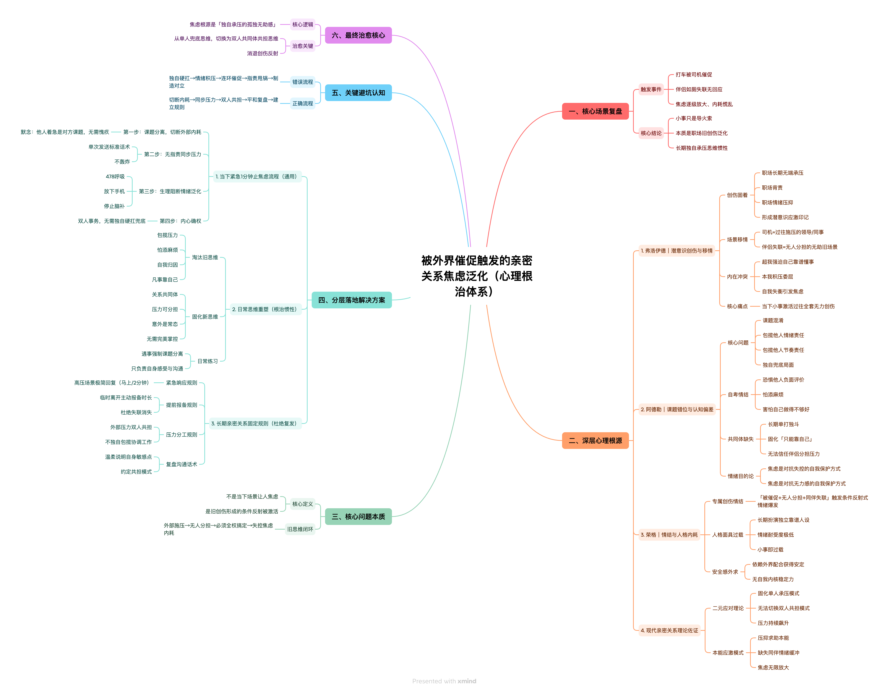
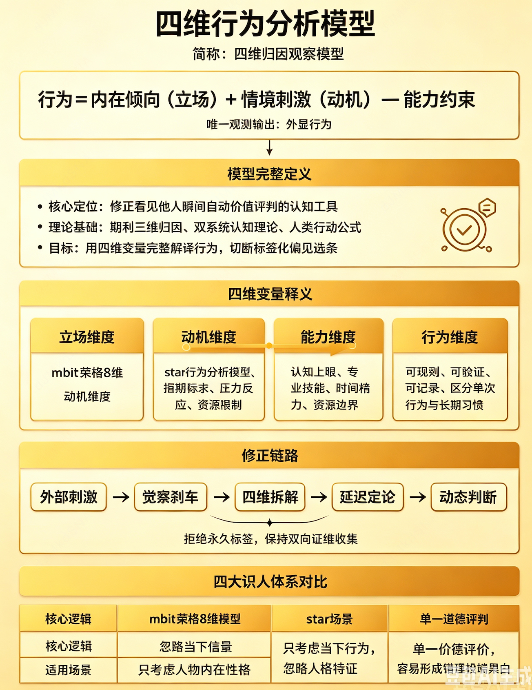

# 2022.01.21
背景:和陈志五聊天,他觉得尴尬,然后问我团队情况,我说了陆佳伟的绩效
结果:陆佳伟生气
分析:涉及到他人的利益相关的信息,不要泄露,别人会觉得损失
# 2022.01.25
背景:李国宇领导需要让人拿衣服,叫了陆佳伟和我旁边的李志刚,没有叫我,我很生气
结果:我很生气,我觉得要么他觉得我搬不动,这对我是侮辱,要么他觉得和我不熟,我觉得他有安全感和他熟,他却觉得和我不熟,
     我觉得很生气,我觉得感情亏了
分析:别人怎么做我即使干涉了,还有很多类似情况,我干涉不完,只能课程分离,课程分离不是对别人好,只是让自己不要因为别人的行为浪费太多时间,消耗
     太多在不必要的事情上
# 2022.07.15
学会分析人物之间的关系，从而知道自己的行动目的
比如领导对外的态度,小弟应该采取的措施
# 20241216
看到别人获奖会感到失落,自己的价值没得到实现
# 20241218
失落,听兰银斌说梦阳很看好宇迪,很失落,很愤怒,感觉不公平
为啥别人不咋努力就可以受欢迎,我这么努力却没人看到我的努力
不要在意别人的说法,关注别人做了什么,我能做什么

洞察真需求:
1.我们和会员域交互需要fuid
2.现金贷业务和我们交互ruid,fuid
3.ruid,fuid我们都没有

谈判:
考虑对方利益,找到对方利益点,让对方接受谈判本身

# 20250320
1.斌哥喜欢一起走，一起和他一起走
2.梦阳汇报情况说详细一点，斌哥在跟，时间不叫紧张没看

# 20250507
1.表达好感,引导到青木那里,为啥?
# 20250510
1.觉得自己没有输出的主线任务,寻找输出的主线任务,写旅行总结
2.建建被别人摸,会感到生气,想独占他,但是大家都是朋友,也没有官宣,所以应该可以随意,官宣后才不能随意摸
nf人比较在意人,会对别人比较在意,显得没有很强的边界感,会喜欢控制别人

# 20250512
1.喜欢一个人后,就想一直关注他,希望他时刻也关注我,如果他没有和我一样热情,就会感觉难受，课题分离
2.自我价值感的确认也与之相关，很多时候，人们通过他们反馈来确认自己的价值，如果对方不够热情，就可能怀疑自己做的不够好，不值得被爱

将注意力和精力放在自己的兴趣和事务上，培养个人独立性。当自己有丰富的个人生活和兴趣时，对对方关注的依赖就会减少，能缓解焦虑，增强自我价值感。

# 20250515
[背景]
liyudi,喜欢捧别人,捧自己,思路是,捧自己是为了证明自己很强,捧别人也是为了证明自己很会处理人际关系,当抬自己和抬别人矛盾时,她会毫不犹豫抬自己.
昨天第一件事,我说我忙,她说哪到哪,她怎么忙怎么忙,是为了证明自己很强，我心理在想你天天9点下班，我天天10点下班，你跟我说多忙多忙，不是在搞笑吗?
第二件事,我在吃吐司,成祥问我他家也有,我说我研究研究,lanyinbi说我讲究,liyudi说研究啥啊,直接买,
[分析]
lanyinbi是不认可我的行为,他觉得讲究不对,在克制自己,但是还是表达出来了,我对此比较生气,觉得和他又没啥关系,又没伤害他,觉得他很小心眼
liyudi是喜欢捧自己,并没有恶意,但是如果她捧她的时候踩了我,我会不开心,昨天就听烦的,甚至想到,以后换工位,不和他两坐一块
[解决方案]
lanyinbin是小农思维,不和他一般见识,直接忽略这件事,因为和他闹,他也不会改变对这件事的看法,他很固执,一定要回避讨论这件事
liyudi平时多捧她,但是涉及到自己的优势以及她通过捧自己打压我时,笑着和她说我的优势


# 20250516
[背景]
别人加我好友,我说中文名,别来说上来就中文名,还说您,我感觉阴阳怪气的,正想理论,但是收回了。什么情况应该断舍离？什么时候应该控制自己的情绪?
[分析]
别人一次说话不流畅，可能是大家上下文不一样，不要因此太过于生气
[解决方案]
不要因为别人一次说的话而生气否定别人,需要多次接触感受这个人的磁场频率，磁场频率相冲的可以断舍离。一次交流不顺利不要情绪波动大

# 20250520
[背景]
生气dp,说我和别人一起买房是为了捆绑别人,说我送礼是因为喜欢教练,很生气，感觉被小看了,被贬低了
而且他说他举报同事,而且是饭搭子,而且背着他举报的,感觉他很得意的样子,感觉他很不公正
他说找一个慢慢相处,平平淡淡的,而且说不急,不需要介绍,我会觉得他瞧不起人,很生气
我说我在表妹那里地位比较高,很难和表妹出柜,他说千万别做地位很高的人,容易很累
但是又要继续和他做朋友,怎么处理上述问题呢?

[分析]
你怎么看一个人,就是代表你是怎么一个人,他怎么看我,代表他是什么人,而不是代表我是什么人,别人否定我不是代表我咋样,而且代表他咋样,他是一个心思不纯的人
他看问题比较片面,没有考虑到很多因素,这是他做的事情，他有自己的因果问题
他拒绝了我的帮助,我也不一定要给他帮助,和他保持一定的距离吧，不近不远的程度
可能他有作为一个地位很高的人?

我喜欢别人顺着我的话说,如果别人一直否定,我会比较生气,会开始疏远他,以此告诉改变他,但是现实是他不会改变,但是我的情绪会因为他的话低落。
远离贬低我的人,或者暗示告诉贬低我的人,不要再这么说话,提示他我是啥人.告诉他这是他的想法，不代表是我。他怎么说我，我怎么说他，对付此类人，不需要
收敛自己的锋芒。

[方案]
1.你咋这么不单纯呢,我们是纯粹的友谊，心思不单纯
2.有啥好举报的，你不怕同事报复你，都是打工人，反馈事实即可
3.多接触才行，感觉你还是对自己喜欢啥类型比较模糊
4.你有类似的经历?说来听听？
从他出发,不要管他对我的评价

[todo]
和不同的人怎么沟通比较好?如果和不同的人用不同沟通方式会让自己变得不是自己喜欢的自己吗?

# 20250521
[背景]
做梦,梦见亲戚给了我们家庭40万,我爸不愿意把钱分给我们,因为他被传销骗了40万,我很难受，从他那里要不到钱
[分析]
我认为和他要钱是破坏家庭,但是如果和他本来就不是一家人,只是形似一家人,为了维护我自己的利益，我可以和他打官司。
[todo]
锻炼沟通谈判的能力

# 20250523
[背景]
今天花了1万,感觉钱不好赚,每年2.3*15=34.5
每年消费17+,存17-,5年存不到100w+,感觉钱太难赚,得好好干活,不然手头上的钱5年就花完了
[分析]
节流+开源
[todo]
每日计算节流多少,开源多少,哪些是节流得到的,哪些是开源得到的
[经济账]
12+10000

# 0525
[背景]
喜欢一个人就会想一直付出,难以保持自我,一旦难以保持自我,别人的一举一动就会让自我难受,情绪波动大。

害怕失去美好的对象，因为觉得自己长期没遇到这种性格合适的，会觉得很虚幻
[分析]
爱一个人就想时时刻刻和他在一起,但是时时刻刻在一起就会过于亲密,失去自我,最终导致双方不再亲密.

不要觉得虚幻，想象自己已经和性格很好的人在一起生活，自己变得越来越好，主导权掌握在自己手上
[todo]
感情好的核心是保持自己的内核,自己的内核稳才能吸引到其他人，每个人都是因为别人的价值而被吸引，而不是因为自己付出多少而被吸引

保持住自己的爱好和节奏，喜欢的人只是锦上添花，而不是雪中送炭，雪中送炭的话，就会随时随地因为别人的举动而波动很大，保持稳定的内核，才会吸引同样内核问题的人
[经济账]
1000(剪头发)
47(买酒)
63(买菜)
281(火车)
42(早餐)

# 0528
[背景]
王阳明杀了那么多土匪,他不会自责？土匪也有好人。他怎么保证一方安定，又能不错杀土匪呢？
[分析]
每个人默认自己都是好人,只是基于什么前提做了坏事，我们有义务帮助他们吗？我们能帮助他们变好吗？我们该嘲笑他们吗？
没有义务帮助他们，但是帮助他们能让你开心，那就帮助。
我们不一定能帮助他们变好，他们自己想变好，我们才能帮助他们
我们在不了解情况的时候不该嘲笑他们，为什么会嘲笑他们？认为自己是好人，承认自己嘲笑别人，但是承认不对

# 0604
[背景]
我说缺人,让jj拉人,他想到拉kb,我忽然有点生气吃醋
[分析]
我直觉认为他和凯宝熟悉,所以拉kb,我把kb当成了假象的情敌,他拉情敌所以我很生气,
也说明我没有彻底信任他,以他的人品性格,他应该是对kb没有想法,才拉上他的。
而且越担心什么,什么事情就越能左右我，我应该完全的信任他，不管他做什么事，我都在
心理认可他
[方案]
加kb好友,把他的朋友变成我的朋友,无条件信任他，引导他成为越来越值得信赖的人，而不是控制他，
越控制他代表越害怕他和别人亲热，代表自己会越失去自我，然后也会失去他。
破局方案就是，保持自我，自己的兴趣继续保持，信任他的人格，鼓励支持他，让他变成更好的自己，这样才能
保持住自己的能量，不断成长

# 0611
[背景]
去jj家很小很挤,会有很大落差,会觉得他很low,觉得和我不是一个层次
[分析]
我把消费观和人是否优秀挂在一起，默认住大房子，愿意消费的人层次较高，节约消费水平低的人层次低。
但是我真正欣赏的是一个人的价值观，消费观，远期目标，情绪价值，执行力
[方案]
时刻提醒自己关注的事情是什么，不断纠正自己错误的意识，明确欣赏他的主线是什么，其余的是副线
欣赏他情绪价值，善良，稳定，自律，可爱，讲段子

# 0619
[背景]
会觉得mdw赚钱很行，wjz赚钱能力不行,会觉得他不行，觉得他层次低
[分析]
容易把人物化,默认赚钱行就是优秀，赚钱不行就是不优秀，喜欢和赚钱强的人在一起
这没问题,喜欢和赚钱强的在一起，但是我得明确我最想要什么，情绪价值还是赚钱能力，还是其他
已经承认人家很优秀了，心理却觉得人家工资低不够优秀
[方案]
时刻提醒自己关注什么，明确欣赏他的主线是什么其他都是副线。

# 0620
[背景]
老胡一直和建建聊骚,我比较生气,觉得老胡轻浮不知廉耻,很想阻止老胡和建建撩骚
[分析]
阻止老胡撩骚,老胡可能会记恨,然后排斥,不利于大家子和睦。
相信建建的为人,他也需要朋友，他也有分寸
[方案]
不阻止建建和老胡聊天，但是得开开心心告诉老胡，我和建建在一起了，得有分寸
[行动结果]
通过其他人的行为和建建聊了此事,建建也有同样的感觉，我感觉心情舒服多了,感觉和建建站在一起面对这些事，对建建不再猜忌,而是共同面对,共同解决
# 0624
[背景]
mdw说还以为不跟他洗袜子,他还在纠结袜子的事情
[分析]
当一个人很执着一件事，说明他很在意这件事，一般是经历了一些难受的事情，也许mdw经历了被别人忽略遗忘,所以他特别在意别人的想法
[方案]
让他感受到我在意他,我们都在意他,感受到没有被抛弃,每天去他房间看看他,和他一起做操,骑电动车带他,一起打羽毛球

# 0624
[背景]
光光撩骚,我比较生气,生气回到了那种状态,大家都围着他转,仿佛他是最优秀的,别人什么都不是

很多人聚餐时，jianjian先给别人夹菜，最后给自己夹菜，感觉有点生气

我给他的豆腐，他平均给每一个人，我有点生气

给每个人夹菜，我也有点生气
[分析]
我生气的是他在享受这种优秀，好像让我变得没那么优秀，我为了自己的好受，希望他做出点什么。希望在一个认可我的群体中，而不是在一个认可别人的群体中
嫉妒他比我受欢迎，评估伴侣是否因受欢迎而忽视你，还是你因自卑放大了威胁感，每周投入时间做一件能体现你价值的事（如烹饪、绘画），增强内在满足感。

内在逻辑，他们不停下来，是因为觉得我们好说话，不会拒绝。
不喜欢自己默默承受，然后他表现的很有礼貌。

分析我们发展到哪个阶段，你和你家人相处模式？先照顾客人还是先照顾家人？为什么要先照顾客人再照顾家人

给每个人夹菜,这是比较亲密的行为，他对每个人都亲密，而且没给我夹菜,让我挺生气
[方案]

以后帮别人弄菜，直接把菜分成两份，每个地方各一份，不要再给别人夹菜了

# 0625
[背景]
对他的要求也变多了,希望我的付出,在他这里有回报,没有回报觉得很没劲
希望他聊天能有一些内容,不要这么干巴巴
[分析]
对他慢慢失去了新鲜感,希望他能付出,而不是我单纯付出,
[方案]
开玩笑跟他说,我做了什么什么,他怎么回报我?
有义务引导他去做一些事，但是不要强迫他去做这些事，让他自己去思考做这些事

[讨论]

# 0626
[背景]
工作时被打扰会很烦

产生一个想法,和mdw一起生活最大的问题是什么?pua?没有家的概念?消费观念不同?为啥对他有留恋?
因为他需要我,在他这里我得到了成长,在别人那里我感觉自己被贬低,在他这里我感觉自己被抬高
[分析]
被打扰打断了心流,会觉得很生气,希望心流的感觉

我喜欢这种做正确事情的感觉

钱给我带来自由感,尊贵感和安全感,
mdew
和他在一起的劣势:无趣,没活力,孤独,喜欢pua,慢慢有家的概念,消费观也在慢慢变化,被否定
和他在一起的优势:有钱的感觉,无微不至的照顾,优秀的感觉,被需要的感觉,自由的感觉,没有人争抢的感觉,很安全的感觉

wjz
和他在一起的劣势:有趣,有活力,不孤独,有家的概念,被肯定
和他在一起的优势:无钱的感觉,没有被需要的感觉,感觉不自由,有人争抢的感觉,不安全的感觉
[方案]
躲在一个地方工作

# 0704
[背景]
依赖别人的事情，等待别人的事情特别烦，不停地被打断，脑袋很疼，特别讨厌这种事
[分析]

# 0910
[背景]
我依赖别人输入，qa催我给逻辑，我会很紧张,感觉是我的职责
[分析]
我负责催,但不开发不是我的自责,把压力抛出去
[方案]
不要把压力全抗在自己这里,能把压力甩出去

# 1021
[背景]
和jj,lm一起出去徒步,jj对lm无微不至,嘘寒问暖,让我觉得他没有边界感,很生气
jj把东西给lm插好喂给老马也让我很烦心，过于亲密的行为
lm对jj越来越有好感,我也很生气，感觉被挖墙角了，被比下去了,被孤立了。
感觉自己很差劲，没有价值感，自己很无能，被否定

jj一直问路人,感觉不信任我，我也很烦躁
[分析]
嫉妒，占有欲，他的没边界感让我很烦
[方案]
和他细节分析，他做这些是什么行为和动机，是否有改进的可能性
比如他要去帮助别人时，能不能先给我打个招呼，照顾我的感受，一直让我照顾别人的感受会消耗我的能量

表达吃醋了,但不要生气
照顾老马的情绪和感受,尽量在建建面前少太秀恩爱
# 1022
[背景]
领导追问问题，感觉被领导责问，压力就会比较大，不舒服
[分析]
感觉自己被质疑了，像是做错事了，怎么做都是错，感觉被领导质疑，是犯了很严重的错误，呼吸困难
问题是否严重？责任是否在这里？追问自己!=责任在自己，领导追问!=问题严重

[方案]
如实反馈问题,不要默认领导在责问自己

# 1028
[背景]
感觉建建情绪不高,想询问他原因,又怕但关注他情绪,导致关系恶化
[分析]
我真的关心他情绪吗?还是说感觉他没有像以前一样热情,因此胡思乱想,希望他和以前保持一样热情,控制他达到以前热情的状态。
[方案]
每个人都有情绪低落高涨的时候,客观对待这个事情,当他需要安慰时,进行安慰。没有主动寻求帮助时，不进行安慰，避免让别人感觉
到压迫感，和控制感，让别人自己主动表达出情绪，如果别人不想表达，就不要过多关注别人的情绪。

# 1030
[背景]
1.被老马否定,说我没有人类的感情,导致今天情绪不高
2.看到季广磊请教李宇迪，感觉李宇迪特别受欢迎,想起高中时班中其他人受欢迎，自己羡慕别人
想起周冲做医生，周冲和李强关系好，是李强指导周冲做医生
3.周志星去巴西,让我觉得要处理好人际关系,没有和公司处理好关系

[分析]
1.我还是特别在意身边人的想法，别人的想法，特别是身边最重要的人，对我的认可特别重要，会直接导致我情绪不高，但是我仍有选择自己情绪的行动力

2.自己也想成为一个受欢迎的人，但是别人请教他，是因为别人觉得她很亲切，我真的想帮助他吗？也许我只是希望认可？

3.开始有点否定自己,自己真的喜欢社交吗?还是喜欢受欢迎的感觉?还是自己能量比较低

4.怎么把握自己的定位，让别人愿意分享资源给我

5.觉得自己好失败，没有和公司处理好关系，羡慕别人去巴西，但是让他去巴西也是业务所致，公司业务需要他爱

[方案]
看相关书籍


[背景]
一直选择晚餐,不知道自己想吃什么,处于游离状态,下次想好吃什么再选择,做个高效的人

# 1107
[背景]
失控场景容易慌,胸闷,想逃避，不知道咋处理
[分析]

[方案]

# 1114
[背景]
自己胸闷心情不好时,对同事充满敌意,充满埋怨,挑刺。对自己的对象也会泛化,觉得他每周都回去,不陪伴我
觉得他没有做出实际行动,只是嘴上说些漂亮话,做些漂亮事,但是没有实际行动。

每周自己回去享福了，留下我自己消化情绪和难过，感觉他好自私。感觉他其实对别人漠不关心。
觉得自己对他那么关注，那么喜欢他，他却每周都跑回家，每周相处时间本来就很少，周末还要跑回家。
越想越生气，觉得不公平，我对他那么用心，他每周只相处这点时间，根本不用心。

[分析]
越来越亲密，对他的定位就会越来越高，就会对他的要求越多。觉得自己的很多情绪都应该由他来帮忙一起消化。
成长性思维，觉得自己和他的关系应该更近一步，他应该像我一样付出很多，而不是嘴上说说。
但是侧面也说明了我越来越需要他,对他的需求越来越高,对他的依赖越来越高。
依赖越高，诉求越高，就会陷入恶性循环。
依赖=重要性?怎么证明他是重视我的呢?怎么证明他爱我呢?需要他重视我吗？需要他证明爱我吗?
对他的定位是什么?对他的期望是什么?
我想要什么?一个完全依赖的对象?一个一起出去玩的对象?一个聊天的对象?
对他期望降低，是不是对他的爱也应该降低？我会不会感觉不公平?

[方案]
对他的定位是爱人，但是每个人都不一样的，如果觉得自己付出过多，感觉到不公平时，和他沟通。
沟通看他的态度，对他的期望没那么高，但是得让他知道我的付出。

期望和他发展下去，就得带着发展下去的目标和动机去做事情。
的确会对他依赖比以前多，但是也不能无限制依赖，到了峰值后容易波动，知道关系也有峰值和谷底的。
掌握自己的主节奏的前提下，可以对他适当依赖作为添加生活的乐趣，而不是把对他的依赖当做生活的主旋律。


# 1207
[背景]
我说买了6盒,只吃了三盒。lh夸jianjian,虎里虎气很可爱,我感觉有点生气
[分析]
我感觉我的情绪被忽略了,lh夸建建,让我感觉建建啥都好,我不应该说建建.我感觉有点小生气
所有愤怒的背后，都是未被满足的需要.我的惭愧情绪没被认同,反而他夸了建建,让我有点难受.
让我觉得反而有错.
[方案]
我希望得到朋友的认可,但是只会有1/3认可我,所以我的重心放在1/3认可我的人那里,其他人保持礼貌.


# 1216
[背景]
1.带了三瓶玉米汁，想着给没吃饭的朋友急救，但是目的太明确，一直问别人
1.在故宫夺取攀攀饼干，表现自己的可爱
2.在攀攀家，对hsy很生气，吵闹，怕大家被他坑了
3.和青木，老胡表达对波波的生气，并表示以后不再叫波波
4.波波拄着拐杖都要来玩游戏，我说让他注意安全，他说要出来跟我们玩
5.青木发了很多situ,我当时感觉青木很轻浮

[分析]
1.可能会让有些人觉得抠抠搜搜，小题大做，的确是要给需要的人，但是尽量当别人主动提需求时再给，而不是自己问别人有没有需求
1.表达自己的可爱，但是攀攀和我关系亲密吗?我觉得和攀攀关系亲密了，但是攀攀不一定这么觉得
2.对hsy很生气表态，当时自己很担心大家被他骗，毕竟波波是自己带来的，他又是波波带来的，自己很有责任心，但是大家可能不太明白上下文
3.和青木老胡表达生气，是因为信任他两，但是忽略了他们可能也做过类似的事
4.很生气，感觉他强迫别人照顾他，一点眼力见都没有，很自私
5.可能他比较在意感受和刺激

[方案]
1.别人问的时候给，不问不给
1.下次很多人出去玩，得提示自己，我和他感到亲密，我能确认他也和我感到亲密吗?
2.在别人表达生气，可能让主人觉得尴尬，可以当大家说这个事情，但是不带情绪的说，客观描述事实，比如hsy你真会勾搭呀，波波都被你勾搭了，你可别勾搭我的朋友，我可不会放过你
3.尽量在大众场合不要表达自己的情绪和喜恶，避免造成误解，每个人有自己的经历，如果我无法判断，就尽量不表达喜恶
4.以后不叫他了，感觉他很自私
5.他没伤害不尊重任何人，尊重他的爱好，不要因为别人和自己不同，就使用道德标准评价别人

# 0128
[背景]
别人把东西放在我桌面上，我有点难受，想移过去。但是我担心别人评价我小心眼，我很在乎别人的看法

[分析]
fe关注和谐，Ni有洞察力，可能会注重边界感，通过小事联系到很多边界感问题，不喜欢被侵犯边界，但是又注重和谐的想法

[方案]
不说话，直接微笑的拿过去放着，让我觉得可以执行。避免使用Ti逻辑劣势造成逻辑僵硬。

# 0415
[背景]
和建建吵架,觉得他很自我中心,不关注身边人,只关注自己的情绪
我骨折去医院，他没说过要来医院看我，我过年在家养伤，他没说来看我，但是程程来看我了，凯哥来看我了。
感觉他社会化程度不够，感觉他不够关心身边人，感觉他很脆弱，需要人保护

[分析]
此时此刻，我和他处在感情升温阶段，也是对方诉求升级阶段，会对对方有很多诉求，但是如果对方做的不够好，就感觉没达标，又想对方能达标。
比如我生病时，觉得他作为我对象，应该做到能及时照顾我的感受，关心我，而不是我主动让他过来，这样让我觉得他很不值得依靠。
还有过年的时候让他来看我，让我觉得他特别不懂事，我身边骨折，他也不主动来看我，每次都是我让他过来他才过来，而且态度还很关心的样子。
让我觉得他只能锦上添花，无法雪中送炭

[方案]
我现在脑海里只有这种想法，感觉我需要冷静远离他一阵子，现在的感情是升温还是降温是个关键时刻，我需要冷却自己的思维后，
然后再思考对策，我需要什么，他能提供什么，是否还能继续走下去

# 0421
[背景]
老胡和攀攀邀请建建去玩,然后一起拍照,并且把他们三人的照片放在攀攀卧室,让我觉得整个过程就很冒昧,没有边界感,卧室是特别隐私的地方,然后卧室的照片放着
他们三人是什么意思?

[分析]
在我的视角，我可能认为他们喜欢建建，然后强行和建建成为三口之家，侵犯了我的男朋友的隐私。不太清楚在别人的视角意味着什么。

[方案]
元宝也说比较冒犯，和我对象沟通后，他后面会说清楚让他们放在客厅。后面我再找几个朋友问问他们怎么看。

后面我也做让他们难受的事情，让他们知道互相理解的重要性。但是现阶段我感觉消耗很多能量，只想远离他们
感觉和圈内的人相处好辛苦，和他们格格不入的感觉

# 0501
[背景]
老胡特别喜欢建建，总想和建建单独相处，建建喜欢玩，不懂得拒绝，我比较生气。我朋友中有个挖墙脚的，感觉我的朋友品德低下。

[分析]
我一直以来都是以品德交友，但是品德是比较个人化衡量标准的，品德交友可以对灵魂伴侣，但是遇到黄人，紫人，蓝人，必须以其他形式交友
如果继续以品德交友，那么自己会收到伤害。

另一方面建建不懂得拒绝别人，是因为喜欢被人崇拜，如果疏远别人怕失去别人的崇拜，但是要梳理清楚边界感和自己的诉求。

[方案]
两方面着手，1方面，和建建沟通他的诉求和他的边界感。1方面明确自己对朋友和搭子的定位。
朋友是指价值观，人生观一致的。
搭子是指在做一些事时可以一起顺路的。

# 0506
[背景]
我感觉我自己没有那么受欢迎，感觉建建更受欢迎

[分析]
老胡喜欢和建建互动，文文喜欢和建建互动，感觉他们都不和我互动。
我真的喜欢和他们互动吗?还是说只是我喜欢他们关注我？点赞我？
我感觉我并没有那么想和他们互动，只是渴望有很多人关注我而已
我的自我认同感是来自他们点赞我，认可我吗？
我的自我认同感一直都是来自自己的状态和节奏

[方案]
他们不点赞关注我，不等于我不优秀，渴望社交我可以主动去社交，但是不要纠结他们为啥不主动找我，可能他们对我的印象就是
我没那么喜欢和他们社交。不要把能量关注点放在为啥他们不主动找我，把关注点放在怎么让自己玩的开心上面。

# 0508
[背景]
最近几天总感觉缺爱,觉得他们不关注我,觉得他们和我玩不来,觉得好难过,感觉自己心里有他们,但是他们心里没有我,感觉很伤心

[分析]
我心里为什么有他们,他们心里为什么没有我?我为什么关注这些,他们不关注我嘛?
他们是istp,istj他们对待朋友圈的态度可能有自己的看法.
感觉自己出去玩都想着邀请他们，但是他们出去玩不邀请我。朋友圈点赞我都会点赞他们，他们不会点赞我
他们不会觉得礼尚往来的必要性，他们是istp,istj是另一套逻辑
我会觉得付出没汇报,但是他们可能本身就不在这套逻辑上

[方案]
把[注意力放在关心自己的朋友]上,他们和自己不同频,那就不要求他们以相同的方式回报.
不能以相同方式要求他们,不是他们冷落我，只是我们社交模式天生不一样，把他们当成性格天生冷淡，不懂情感回馈
偶遇就一起、他们找你就回应，不主动凑局、不刻意惦记。我难过归难过，但不否定自己、不卑微讨好、不强行融入他们的圈子
错的不是你，是大家性格不同、同频不了
不主动走心倾诉很深的情绪，因为 ISTJ/ISTP 接不住你的情感需求
不期待他们主动找你、主动约你、主动给你点赞，把期待降到最低，反而一点都不会伤心了
把他们当成[陪你做事的人，不陪你走心的人]
把「搭子」当成了「真朋友」来真心对待、用真心朋友的标准去要求他们
只一起玩、不走心、不惦记你 → 搭子
互相惦记、互相在意情绪、双向主动 → 真朋友
不要把所有身边人，都当成值得走心的好朋友。有的人只配当搭子，浅浅相处就好，不用投入情绪。

# 0511
[背景]
感觉自己需要朋友,害怕孤单,但是又不太能融入他们,只适合调节氛围.
因为绿人本身就比较少,雷达比较响,知道和他们不是最合适的一类,想自己舒服自在,但是长期的孤单
也会让人想要朋友

# 0525
[背景]
总感觉被周围人不理解,不喜欢,被周围人否定,被否定后就觉得自己很失败,就想远离他们

[分析]
把别人的接纳、肯定等同于自我价值。被否定、不被理解时，潜意识判定 “我不被爱、我无价值”，触发自卑挫败感，本能启动心理防御：疏远人群保护自己，避免再次受伤
外在人格：向外索取温暖、朋友、认同，迎合群体期待
内在阴影人格：敏感、高傲、精神独处、三观挑剔
你表面想合群，内心对相处模式、三观、谈吐有高标准，潜意识排斥浅层敷衍社交，自然无法真正融入，形成里外拉扯。
人都追求共同体归属感，但你陷入认可欲求枷锁：活着为了获得他人喜欢，一旦得不到，就自我否定。同时你习惯站在他人角度共情，却很少被同等理解，付出不对等加剧孤独

切断价值与他人评价绑定
记住：别人的否定，只代表对方认知，不代表你失败。不再把 “被喜欢” 当作自我合格标准，你的价值由自己定义。

接纳独处与合群共存
不必强迫自己彻底热闹，也不用强行封闭自己。接受自己既能享受欢聚，也需要独处回血，不用逼自己融入所有圈子，只筛选三观契合的人深交

普通人相处本就有误解、分歧、不认可，没人能被全员喜欢，减少心理落差

[方案]
浅层热闹随心参与，不必强求交心，轻松相处反而自在
被否定时不立刻自我怀疑，客观区分：是意见分歧，还是恶意评判
不必刻意讨好迎合，真实做自己，吸引来的才是同频朋友

被否定低落时，先独处平复情绪，不要一次性疏远所有人。慢慢小范围互动，慢慢找回舒服的人际节奏。


# 0527
[背景]
想去,想问梦阳情况,又有点紧张,怕不能去,给自己争取机会,不一定能去，但是给自己争取权益就是一种锻炼.

[分析]
已经争取询问,梦阳也表达了努力和拒绝原因

[方案]
我做了努力,梦阳表达了态度,我也表达了态度

# 0609
[背景]
上班容易焦虑的场景总结
1.很多人找我的时候容易焦虑烦躁,不知道处理哪个事情，感觉处理不完的事情
2.被esfp伤害后，遇到其他esfp也容易还未受伤害就开始应激反应
3.很多同事喜欢在群里口头沟通,方案不落实技术方案和prd,很多时候需要叮嘱追加,执行成本非常高,遇到研发开发和qa测试,浪费大量时间口口相传
4.很多业务逻辑梳理在产品，策略，研发模糊边界，最终都变成谁的口才好就可以不梳理，职责划分很不明确,当需求爆炸时，对接的梳理任务全集中在一个人身上
5.被别人强制带进到别人的需求去帮忙,不帮忙会觉得自己很冷库,帮忙会觉得自己时间都被打黑工占用
6.感觉被人一句话都要浪费很多时间去排查，很浪费时间很消耗，为自己的时间被浪费有点不开心
7.别人@我好像这个问题我就有义务解决，让我很焦虑，没解决这个问题好像我有未完成任务
8.听到张健的声音就烦躁,感觉他就要pua,就会难受,就感觉焦虑
9.需要别人审批,通知别人好几次还不审批,等待很焦虑,感觉失控
[分析]


# 0624

[背景]
我打到车了,司机催我时,我催我对象.但是我对象上厕所没理我,让我很焦虑,然后我再次催他,他还不出来,我就更焦虑了.
以前我上班时也经常因为被别人催着，本来不是我的问题，但是压力全落在我这里了，导致我很难受，有点焦虑.我猜测导致这个情节泛化到生活了,和亲密关系相处遇到相似的场景也会焦虑不知所措
[分析]
一、弗洛伊德（精神分析：童年根源 + 潜意识创伤、移情、情绪固着）
1.创伤固着：职场长期压力形成潜意识应激印记
弗洛伊德认为：重复、持续的被动压力会形成情绪固着点。
上班时：事情根源不是你，催促、指责、时间压力却全部砸向你，你没有渠道释放委屈、无力，情绪无法完成 “宣泄 - 消化”，只能压抑进潜意识。
你的潜意识记住一组绑定信号：
他人催促 + 只有我一人承担全部外部压力 + 无人分担、无人回应 = 危险、无助、失控
这个神经绑定不会只限定在职场，只要生活出现同结构场景，潜意识立刻调取旧创伤情绪，也就是情绪移情


2. 本次场景的移情投射（核心关键点）
   司机催促 = 当年催你的同事 / 领导（外部施压者）；
   对象沉默不回应 = 当年没人替你分担、没人站你这边；
   你当下的焦虑，不只是 “怕司机不耐烦”，是潜意识把当下的等待，等同于过去长期独自扛责的无助创伤。
   表层诱因是打车，底层爆发的是积压多年职场压抑的无力感

3. 本我、自我、超我的内在冲突
   本我：想摆烂、直接跟司机说不等、生气指责对象，逃避压力；
   超我：道德规训 —— 不能麻烦司机、不能乱发脾气、出门要守时、我必须负责协调好一切；
   自我（调节者）力量薄弱：一边外部施压，一边伴侣无反馈，自我无法平衡内外冲突，焦虑爆发
4. 压抑的防御机制
   过去职场你习惯隐忍，不表达难受，使用「压抑」防御；但压抑不会消失，只会降低情绪阈值。
   现在一点微小同款压力，焦虑直接过载，也就是你感受到的 “明明只是小事，我却控制不住心慌不知所措

二、阿德勒（个体心理学：课题分离、自卑情结、追求优越、共同体感受挫）
阿德勒不追溯童年创伤，聚焦当下的认知、责任认知、人际关系课题，完美解释你的泛化行为。
1. 核心问题：完全混淆他人课题，强行包揽不属于自己的责任
   阿德勒课题分离理论：
   1）司机等待、司机烦躁，是司机的课题；
   2）对象上厕所快慢、是否及时回复消息，是对象的课题；
   3）只有你的情绪、你的沟通方式，是你的课题。

   过去职场：你习惯性承接别人的焦虑，把别人的催促内化成 “是我没做好”；
   现在打车场景重复旧模式：司机着急，你默认全部压力由你来兜底，默认你必须搞定一切，一旦伴侣无法配合，你立刻陷入自我消耗。
   你默认：所有外部冲突、时间压力，都要我一个人解决，没人能依靠。

2. 隐性自卑情结：害怕自己给别人添麻烦，害怕被他人否定
   长期被催促塑造了你的底层认知：一旦我造成他人等待，我就是累赘、做错事的人。
   深层自卑：极度在意他人负面评价，恐惧司机反感、反感自己办事拖沓；当伴侣不能配合你 “完美守时”，你会放大灾难化想象，焦虑升级。
3. 共同体感觉缺失（亲密关系里的孤立感）
   阿德勒提出，健康关系会有「共同体感」：遇到压力时默认伴侣是战友，共同承担问题。
   但过往职场长期单打独斗，让你形成思维惯性：凡事只能靠我自己，别人不会配合我、不会分担我的压力。
   对象不回消息，瞬间激活 “我孤立无援” 的负面预判，焦虑加倍。
4. 行为目的论：焦虑是你逃避无力感的工具
   阿德勒目的论：不是场景让你焦虑，是你需要焦虑这种情绪，来合理化你的烦躁。
   你内心无法接受 “掌控不了局面”，焦虑的情绪其实在暗示：我很着急，我很努力在协调，错不在我，是外界和伴侣不配合。
   焦虑本质是你对抗 “失控无力” 的心理手段。

三、荣格（分析心理学：原型、阴影、情绪情结、集体无意识、人格阴影投射）
1. 「无力等待情结」—— 独立存在的心理情结（核心概念）
   荣格的情结：一组捆绑记忆、情绪、感受的心理单元，会独立触发情绪，不受理性控制。
   你形成了专属「被催促独自等待情结」：
   触发信号：第三方催促 + 同伴失联无法配合
   情结被激活时，理性思维下线，心慌、慌乱、焦虑、不知所措全部涌出，这就是你说的 “泛化”—— 情结不分职场 / 生活，只要匹配场景就自动启动。
   情结来自你长期未被看见的委屈，属于你内在未整合的受伤子人格。
2. 阴影投射：把内在压抑的烦躁投射给对象
   你的内在阴影包含：愤怒、委屈、想摆烂、不想独自扛压力；
   职场中你不敢释放这份阴影情绪，只能压抑；
   到亲密关系安全场景，阴影向外投射：对象迟迟不出现、不回应，你潜意识把所有积压烦躁归咎于他，反复催促本质是想让他承接你无法消化的压力。
3. 自我与自性的断裂：你过度向外索取 “可控感”
   荣格认为完整人格需要内在安定（自性），但你的安全感完全依附外部条件：司机不催、伴侣及时回应、一切按计划走，你才安心。
   一旦外部脱离预期，内在稳定的核心（自性）没有力量托住你，立刻陷入精神失衡、焦虑。
   你缺少向内安抚自己的能力，只能依赖他人配合来缓解不安。
4. 人格面具过载
   职场上你长期佩戴「靠谱、负责、独自处理问题」的人格面具，长期消耗内在能量；
   面具长期紧绷，导致你的耐受阈值极低，生活里一点点同类压力，精神直接过载崩溃

[方案]
2. 阿德勒视角：课题分离，重塑认知，建立共同体思维
   强制划分课题：司机等多久是司机的事，不必为对方情绪负责；对象上厕所快慢是他的事，你只需要表达你的感受，不用全权兜底局面；
   破除灾难化思维：迟到几分钟没有严重后果，不必过度放大他人的负面看法；
   和伴侣建立 “战友共识”：遇到外部压力共同承担，不用自己一个人硬扛。
3. 荣格视角：整合情结，向内建立安全感，接纳内在阴影
   觉察情结触发信号：一旦心慌焦虑升起，立刻意识到 “是我的等待情结被激活，不是当下这件事本身很可怕”，拉开自我与情绪的距离；
   向内自我安抚：不必等伴侣回应才安心，通过呼吸、独处稳定内在，把安全感从 “他人配合” 转移到自身；
   接纳内在的烦躁阴影：允许自己不想承担压力，不必永远强迫自己做靠谱、懂事、独自扛事的人。

落地解决方案

1. 当下紧急场景｜1分钟止焦虑流程（打车/赶时间/被催促通用）
- 第一步：切断外部压力内耗（课题分离）
  默念：司机的着急是他的课题，不是我的错，我不用为他的情绪负责。仅礼貌安抚一句，不再反复愧疚、反复道歉。

- 第二步：正确同步压力，不指责、不甩锅
  只发1条消息，停止连环轰炸：“师傅一直在催我，我一个人顶着压力很慌，你方便的话尽快出来，抽空回我一句我就安心。”

核心：把「我独自承压」转为「我们共同面对问题」。

- 第三步：生理平复，阻断情绪泛化
  478呼吸法+放下手机不脑补，杜绝盯着屏幕灾难化胡思乱想。

- 第四步：内心确权
  这件事是两个人的事，不是我一个人的责任，不用独自硬扛所有局面。

# 0629
[背景]
感觉自己能感受到别人情绪的变化，然后会开始内耗别人喜不喜欢我，是不是我说错话了，我怎么样快速让别人重新高兴起来，感觉自己有义务让别人快速开心起来

[分析]
我在想，可能是我引起别人情绪不好，但是不是特别大的事情，我不应该被别人情绪左右，我应该掌握节奏，主动忽视别人情绪问题，正常和别人相处，弱化需要处理情绪的能量

[方案]
知道是什么原因导致的，可能不明牌说，但是在这方面给与鼓励，
能感知到是你的特质，但不代表你要主动行动、反复内耗
浅浅表示体谅，不深挖原因、不自我归责，说完收回注意力，回归原本相处节奏


[背景]
其他人负责的需求,涉及到我开发的项目,他的需求遇到问题直接让我跟进问题,我觉得流程不对,应该是他跟进问题,遇到问题可以问我

[分析]
我可能感觉想帮助他做，他很忙，我不忙，这个问题很着急，但是帮他解决这个问题对我没有任何收益，我不应该帮他解决，而且他跟进，我来支持

[方案]
如果是特殊情况可以临时帮助他，但是得和他明确边界

# 0630
[背景]
我知道mbti的存在,也能凭直觉大概知道那个人是什么类型,但是没法系统说出那个人有啥行为体现了mbti,区分不开哪些是后天训练出来的特点,哪些是天生的特点.需要看书分析

[分析]
开始着手细节分析mbti

# 0709
[背景]
六年级摔了一次胳膊，然后后来和我爸吵架又断一次.
[分析]
今年摔了之后,会联系到前面有过两次,担心自己今年还摔一次.产生这种担心是自己的联想能力和归纳能力.喜欢寻找和总结规律.不是真的会发生这种情况.
这份焦虑不是 “预感灾祸”，是联想能力 + 归纳总结本能共同触发的心理推演

为什么明明知道不一定发生，还是控制不住担心?
大脑的风险预警系统不分 “严谨规律” 和 “片面总结”，只要归纳出重复负面事件，就会自动拉响警报。
哪怕理智上清楚现在骨骼、身体状况、摔倒力度都和小时候不一样，可联想会率先调动过往受伤的痛苦记忆，恐惧感受会先一步冒出来，理智只能事后慢慢说服自己

[方案]
建立一套永久覆盖旧认知的完整规律
罗列所有反向事实（推翻旧联想）
客观记录所有 “摔倒但没骨折” 的经历：近几年磕碰、滑倒、轻微撞击全部算进去，这些都是推翻 “一摔就断” 的客观证据。

遇到同类事件，强制先找「差异」，而非只找「相同点」
你之前习惯只抓取共同点：都是摔倒、都骨折；
以后训练思维：先找不同 —— 年龄、力度、场景、骨骼状态，差异优先，从根源减少片面负面归纳。

区分 “预警感受” 和 “事实预判
这只是大脑风险预警本能（感受）≠ 这件事一定会发生（事实）；
把恐惧归为生理提示，不是未来预兆，降低念头对你的影响力

关键避坑：不要对抗想法
千万不要告诉自己 “别想这件事、别担心”，强行压制会让念头反复强化。
正确的覆盖逻辑是：不消灭念头，用一套证据更充分、逻辑更完整的新想法，把旧负面联想挤走、覆盖替代，利用你本身擅长归纳总结的思维特质，从底层更新判断标准。


[背景]
我喜欢社交认识朋友的感觉,但是我又担心社交一段时间后关系没拉进,其他人却变亲近了,我并没有和其他人变亲近.

[分析]
同样一群人相处一段时间，别人两两变熟、私下互动变多，唯独你停留在浅层客气，大脑自动归纳出负面结论：“只有我没能走近任何人，我社交失败”。

ENFJ 天生的底层需求：需要 “双向深度回应” 确认自身价值

独处机会：聚会后单独约饭、顺路同行、私下私聊，一对一独处是拉近关系关键

而你大多是群体里的全局型陪伴者：ENFJ 习惯照顾全场所有人，均匀分给每个人善意，很少单独锁定某个人深度私聊。均匀热情反而很难快速和某个人形成专属亲密感，这是你的社交模式选择，
训练你的差异思维：看到别人关系变好，第一时间找差异变量（有没有私下接触、有无过往交集），而不是对比 “我为什么不如他们”


# 0711
[背景]
疑惑为什么日常交往和工作交往的模式不同,日常是价值理性，工作是工具理性？怎么理解这句话?我在工作上做不到工具理性又是为什么
[分析]
[方案]
推荐书籍:
《西方现代思想讲义》
《学术与政治》

[背景]
有负面能量的人往往都有其对应的正面能量

# 0713
[背景]
外部刺激->心理价值评判->符号->命题，为什么我看到一个人的样貌会立即对一个人进行价值评判，我想客观评判，怎么做到
[分析]
这套即时评判不是你主观想做，是大脑两套本能机制驱动：
生存节能机制（快思考 / 系统 1）
大脑每秒接收海量人脸、神态、动作信息，为了不用费力分析，会用过往经验、偏见、创伤、审美、利益标准一键打分。看见一个人 0.1 秒内就完成好恶判断，全程无意识，根本拦不住。
自我保护的价值坐标系
每个人内心自带一套隐形标尺：颜值、财富、谈吐、地位、性格是否顺你的心意、会不会伤害你。看见他人相当于把对方扔进你的标尺自动测量，立刻分出 “高价值 / 低价值 / 威胁”，用来快速决定亲近或远离。

自动评判是本能，客观是后天刻意训练，本能永远跑在理性前面。你无法消除第一瞬间的评判冲动，但可以切断 “评判→贴标签→固化偏见” 的链条。
[方案]

第一步：觉察刹车 —— 识别自动评判，区分「本能感受」和「客观事实」
看见人产生好恶情绪、价值打分时，立刻做分层拆分（核心关键）：
标注本能（允许存在，不用自责）：
“我现在内心自动给 TA 打了低分 / 高分，这只是我的主观感受，不是事实。”
严格分割两类信息：
客观事实（可验证、无褒贬）：TA 今天穿黑色衣服、说话语速快、打断了别人、年收入 XX、说话音量大；
价值评判（纯主观、带褒贬）：TA 很傲慢、俗气、优秀、卑微、讨人厌。
练习口诀：凡是带形容词好坏的，都是我的评判；只有能拍照记录、第三方无争议描述，才是事实。
举个例子：
本能评判：这个人很自负（主观打分）
客观事实：他发言时多次打断他人，很少询问别人观点。
你所有快速价值判断，都来自你自带的单一标尺，客观化的本质是拆掉单一标尺，建立多维度观察框架。
1. 找出你的单一评判陷阱（常见类型）
   外貌标尺：长得普通 = 能力差；打扮朴素 = 没本事
   情绪标尺：说话直 = 情商低；不讨好我 = 冷漠
   利益标尺：对我没用 = 低价值；能帮我 = 高价值
   过往创伤标尺：某人像曾经伤害你的人→直接判定危险
2. 建立多维中立观察框架（看人不用 “好坏”，只用维度记录）
   每次想评判一个人，强制从 4 个无褒贬维度记录，禁止直接下整体价值结论：
3. 
   行为维度：TA 持续做什么事？单次偶然行为还是长期习惯？
   动机维度：TA 这么做的环境、处境、诉求是什么？（不默认恶意）
   能力维度：擅长什么、短板是什么，不分高低，只区分领域
   立场维度：TA 的成长、身份、需求和我不同，立场天然有差异

第三步：延迟命题固化，用「待定视角」替代下定论
你的链条里最影响客观的一步：快速形成固定命题（TA 是 XX 的人）。客观的核心操作是无限延迟定性结论。
建立规则：单次接触绝不定义一个人的整体价值
一个行为、一次见面、一个神态，只能代表 TA 当下那一刻的状态，不能等同于这个人全部。
人是流动的：压力大时暴躁、放松时温和，短期样本不能概括整体。
替换内心话术：
禁止：TA 是一个自私的人（永久定性命题）
替换：在这件事里，TA 优先考虑了自己的需求，暂时不清楚完整背景，先存疑观察。
增加反向证据搜集（打破单向偏见）
如果你下意识觉得某人很差，主动刻意寻找 3 个 TA 中立 / 正向的客观行为；

如果你下意识觉得某人完美，主动寻找 3 个客观局限行为。

单向滤镜会自动放大一类信息，主动找反面信息才能平衡视角。
```aidl
行为 = 内在倾向（立场） + 情境刺激（动机） − 能力约束

内在倾向：你长久的身份、需求、价值观 → 立场维度
情境刺激：当下环境、压力、短期目标 → 动机维度
能力约束：认知、技能、时间、资源短板 → 能力维度
行为：公式输出的最终结果，唯一可验证项 → 行为维度

只看行为：只看到结果，不知道为什么这么做，直接道德评判；
只看动机：凭空揣测内心，没有事实支撑；
忽略能力：把 “做不到” 当成 “不想做、恶意”；
忽略立场：用自己的需求、成长背景去对标别人，产生对立偏见

1. 不能合并的理由（四者边界清晰，无法互相替代）
立场（长期底层）≠ 动机（短期当下）
立场是稳定底色，动机是临时状态。
例：一个人底层立场是重视公平（长期），但当下缺钱临时占小便宜（短期动机），二者不能混为一谈。
动机（主观想要）≠ 能力（客观能做到）
有善意不代表有能力做好，能力不足会产生糟糕行为，不等于动机恶意。
能力（内在条件）≠ 行为（外在表现）
能力是潜在条件，行为是实际输出；有能力不代表一定会表现出来。


性格模型（MBTI、九型）：只讲「立场 / 内在偏好」，缺失动机、能力、客观行为，容易静态贴标签，加重评判；
行为面试 STAR 模型（情境 - 任务 - 行动 - 结果）：只聚焦单次行为和情境，缺少长期立场、能力短板分析；
道德评判模型（好人 / 坏人）：只单一维度，完全忽略动机、能力、立场，就是你想摆脱的即时价值评判；
凯利三维归因：学术化，普通人难直接使用，四维是它的轻量化落地版本。
```

# 0720
[背景]
感觉自己的对象被朋友欢迎，自己不受欢迎,被冷落,融不进去
感觉自己在失去室友老马,有失落感,但是感觉也不应该阻碍老马展开新生活
感觉别人虽然很菜,但是在创业,自己很难受,感觉自己无所事事,又不想失去这个机会
[分析]
感觉被冷落，可以自己找话题，这只是一种感受，不代表自己没价值，只是恰好他们都喜欢我对象，我不用在每个组织都受欢迎

感觉自己在失去室友老马，老马有除了刷抖音外的其他生活，对老马是更有利的，我对老马的感情建立在老马自己越来越好，不能因为我想绑住老马，就不让他更好，我应该帮助他变得更好

你可以主动成为他的后盾：愿意听他分享新经历、鼓励他去尝试新鲜事、在他受挫时陪伴他，这就是你说的 “帮他变得更好”。
同时留出专属二人时间，不用强行挤进他全新的社交圈，偶尔单独约饭、聊天，保留只属于你们的相处模式。哪怕各自有不同生活，稳定的一对一联结，依旧能守住你们的感情。


我打算先学习读创业相关书籍，对创业的坑了解大概。因为一旦开始创业，就没有太多时间读书成长
[方案]
提前摸清创业各类大坑，降低试错代价
创业启动后会被运营、客源、资金、琐事填满，根本没有整块时间系统读书梳理逻辑。现在空闲期正好补齐底层认知：现金流管理、合伙风险、获客逻辑、法律财税、成本控制等，这些踩坑知识，等开店 / 起步后再学就要付出真金白银。
帮你判断自己到底适不适合创业，避免冲动入场
读完一批实战类书籍后，你能客观看清创业的压力、风险、必备能力，分清：你是单纯羡慕别人有事做，还是自己真的适合、有意愿走这条路。避免单纯被同辈对比的焦虑推着盲目创业。
三、平衡心态的自我暗示
别人仓促出发是一种选择，我沉淀学习是另一种更稳妥的选择。
我不用因为他人的节奏否定自己，当下读书积累不是浪费时间，是创业前性价比最高的准备。
我真心想抓住创业机会，但不会用仓促入场换取 “看起来很忙碌” 的假象，先把风险、底层逻辑吃透，再伺机行动。


# 0722
[背景]
每个行为的背后都有一个正面动机。如果一个人的行为不值得肯定，但至少你可以肯定他的正面动机。

我的室友创业，但是他才认识我 2 周，就要求我给他报名，要求我帮他组织活动，我觉得他没有边界感，怎么从正面动机解读？

[分析]
NLP 公理：所有行为背后存在正面动机；正面动机值得看见，但不代表行为可以接纳、不代表你必须配合。
动机（内在意图）：想要做成某事、获得某种价值（可以理解、共情）
行为（实现手段）：缺乏边界、刚认识两周就强行安排你干活（手段失当，可以拒绝）

表层动机（现实目标）
渴望快速起步、急于拿到结果
初创阶段焦虑感很强，迫切需要人手、流量、参与者；他内心目标是把项目推进落地，希望尽可能调动身边一切可用资源，降低创业启动难度。
想要降低自身工作量，寻求协作分担压力
独自创业负荷大，本能寻找伙伴分摊组织、招募这类琐事，减少自己单人承担的负担。


中层动机（人际与能力信念）
默认 “熟人 = 天然可以互相帮忙”，缺少人际边界认知
在他的心智地图里：认识 = 可以互相协作，他没有建立「熟悉程度决定求助尺度」这条规则。他不是刻意侵犯你，是不知道人和人之间需要循序渐进，刚认识不适合提出高成本请求。
乐观、相信人脉可以快速转化为资源
对人际关系成长速度预期很高，认为短期内就能建立合作信任；他预判 “提出请求，对方大概率愿意支持”，低估了陌生人 / 浅关系的心理距离。


深层核心正面动机（价值观层面）
追求成长、想要创造价值，渴望实现自主目标
选择创业本身，底层动机是不甘于被动打工，想要掌控自己事业、获得成就与自主选择权，拥有属于自己的成果。
期待建立伙伴社群，不喜欢孤军奋战
潜意识害怕独自前行，希望快速组建协作圈子，有人一起参与项目，摆脱单打独斗的孤独感。
⚠️关键提醒：
这些正面动机，只能用来帮助你放下对他的情绪对抗（减少反感、愤怒），不能成为逼迫自己妥协的理由。
动机很好，但是他选用的策略「不评估关系深浅，直接提出高负荷请求」是无效、越界的策略。
NLP 逻辑：人经常会选用不适宜的手段去追求正面意图。

[方案]
肯定正面动机 + 区分行为问题 + 清晰设立边界（不攻击人格）
避免句式：“你这个人没有边界感，不要总使唤我”（评判人格，容易引发对抗）
“我理解你很想尽快把项目落地，希望多一些人参与活动，把创业这件事推进起来【肯定正面动机】。
不过我们认识时间还很短，直接安排我报名、组织活动，对我来说负担比较重，我暂时没办法承担这些工作【指出行为带来的影响、设立边界】。
如果之后有一些轻度、灵活的小事，我有空可以考虑看看。”

# 0823
[背景]
打掼蛋，我的主打特点是让牌友像在自己家里一样不约束,不把他们当客人,不要过多体验地主之谊,就像这个地方没有主人一样

[分析]
对于比较外向的人来说,比较友好不约束,但是对于比较内向的人(如西早),他比较被动,被动等待主人对他的帮助,这个时候可以适当
帮助他,体现地主之谊.

[方案]
目标是让牌友在家不约束,不觉得自己在别人家,对于比较外向的人,不给他们加约束,对于内向的牌友,
他们已经有很多心理负担,需要帮助他们缓解心理负担

[背景]
老马把生肉放到了米饭上面,让我很生气,开始纠正指责他，导致他更生气

[分析]
他不断说不是故意的，我说没有人是故意的，他更生气了，瞬间指责我蠢萌，直接人身攻击，我应该先肯定他做的好吃，香，然后告诉他下次
可以米饭放在哪

[方案]
肯定他的人，然后告诉他这件事后面可以把米饭放在对面桌子上

# 0911
[背景]
今年发生很多事情,有老胡的邀请豪哥凯哥不邀请我,有攀攀的玩桌游发脾气,有青木的不感恩巨婴,有刘洋的口蜜腹剑给健健献殷勤,
有梦豪疯狂输出他的感情说凯哥问题但是对外部环境我们的付出不感冒

[分析]
发展进步势力，争取中间势力，孤立顽固势力
毛泽东 1940 年 3 月《目前抗日统一战线中的策略问题》（延安高级干部会议报告），后写入《论政策》党内指示，是抗日民族统一战线的策略总方针。

也是我们交友的策略总方针

[方案]
发展进步势力(成长性人格，友好型人格)，发展为好朋友，比如 彭建，巩振龙，程程，Q哥，

争取中间势力(有缺点，或者各自为营，或者目光短浅，但是根本目标、利益不矛盾，不相关)，争取成为自己阵营至少不针对自己，比如青木，罗梦豪，老胡，光光，攀攀

孤立顽固势力(利益冲突，口蜜腹剑，说话好听但是实际行动处处都是有损 小胡建建 感情发展统一战线策略总方针)   暂定 刘洋

# 1008
[背景]
有个朋友刚开始说很喜欢我,但是明显感觉和他不知道说什么,价值观差异很大,后来不知道做了什么,引发了他的什么,后面他都不给我点赞了,但是他还
继续给别人点赞,我感受到了来自他的恶意,我很难受

[分析]
我也想屏蔽他,不看他给谁点赞,但是屏蔽他好像只是让我潜意识忘记这个事情,并没有解决这个事情,所以我觉得他不给点赞是他的事情,我给不给他点赞是我的事情
我不想他做了啥我就做啥,因为我觉得只会让矛盾越来越大,以后见面相处成本太高,所以我继续给他点赞,但是我还是有点难受
为啥受伤的总是我,需要承担伤害,需要为别人考虑的总是我?

你很清醒：屏蔽只是隔离刺激源，属于 “眼不见暂时不触发”，并没有从底层消解这件事带给你的感受；你分得清清楚楚：他的点赞是他的课题，你的点赞是你的课题，拒绝对等反击，避免把关系推向对立、抬高线下相处成本。
这是非常成熟的选择，但理性想通 ≠ 情绪自动消失，这就是你现在矛盾的根源。

为什么受伤、包容、思考后果的人总是我？
本质：不是世界专门挑你来伤害，是你的人格天然会优先感知关系里的张力，并且自动承担「关系维稳」的责任，而对方不会。

看到对方行为（不给我点赞，给别人点）→ 立刻捕捉到区别对待带来的伤害 → 同时推演：如果我对等反击，会产生连锁矛盾 → 主动选择不进入博弈，守住体面。
👉 代价：冲突的压力、情绪代价，全部留在你这边消化。
你自动承担「关系的维护者」角色。

为什么 “明明道理都懂，心里还是难受”
理性（Ni+Te）和情绪（Fe）是两套独立系统
你的 Ni 看得清清楚楚：这是他的选择，我不卷入博弈，不要对等报复。
但你的 Fe，天生对「被区别对待」敏感。理性可以指导你的行动，但无法一键关闭情绪感受。
难受不是因为你想不通，是你的共情系统捕捉到了被区别对待的失落，这是本能反应，不是你的弱点

现在的误区：误以为 “我做出成熟选择，我就不该感觉到受伤”
你可以选择包容、不博弈，但包容不等于必须消除受伤的感受。
选择承担关系维稳的成本，是你的主动决策；但你不必要求自己，不能为此感到难过。
很多人会混淆：
我选择不反击 → 我就不能难过。
事实是：我可以难过，同时依然选择不反击。两件事可以共存。

不是你活该，是你习惯性认领了「关系调节器」这个角色。
别人（比如这个 ISTJ）根本不会主动认领这个角色，他甚至看不到这个角色的存在。
人际关系里，谁对氛围更敏感，谁就更容易承接情绪负担。
敏感的人，自动看见风险、预判代价，于是主动承担维稳；钝感的人感知不到风险，自然不需要付出这份心理成本

不要试图去 “证明” 这件事的恶意。
就算你去问他，很大概率他会很真诚地说：“就是刷到没觉得要点赞，线上点赞不重要，线下见面不是挺好吗？”
他不是在敷衍，这就是他真实想法。

你现在的选择：继续给他点赞，不跟他对等博弈，这个选择本身没问题。
但你要区分：你持续点赞，是出于你的原则；但你不必强迫自己持续暴露在这个刺痛你的场景里。
你可以继续保持点赞的行为，同时选择屏蔽他动态。
屏蔽≠报复、不等于宣战。只是不让自己反复看见 “他给别人点赞唯独跳过你” 这个画面，减少一遍一遍的情绪暴击。

[方案]

不用直接摊牌、对峙，不用指责他；
只是降低见面频率，从高频好友，退到浅一点的熟人位置；
线下偶遇或者必要见面，依旧保持礼貌体面，正常沟通。
本质是下调关系的投入等级，减少你的情绪投入，不再期待从这段关系里获得情感层面的对等回应。
你依然可以保留你的处事原则（不做对等报复式冷对抗），只是不再持续投入大量心理能量
 
# 1009
[背景]
对方情绪很激动,说话很不尊重人,感觉没把人当人看,而且他不是我老板,怎么应对这个问题?

[分析]
文字语言 7% + 语音语调 38% + 肢体表情 55%，当一句话的文字内容本身很简单，重点是 “这个人对你是什么情绪 / 态度”

目标 A：[判断对方对你的态度、情绪、动机]（比如领导无端批评、熟人打压）
👉 此时适用 7-38-55。语调、表情、肢体是重点信号。
不要屏蔽情绪信号！用来识别：他是就事论事，还是单纯发泄情绪、试探你的底线。

例：同样一句 “你这个不行”
平静、看着你、指出具体问题 = 就事论事（内容可信）
皱眉嘲讽、拔高人身评价、语气阴阳 = 情绪发泄（内容不用全盘接收）

目标 B：[接收事实信息、理解对方陈述的客观事情]（对方在讲事件、数据、理由）
👉 此时不要被对方情绪带跑，重点提取语言内容。
对方哪怕情绪激动、语气很差，剥离情绪，只抓取里面客观事实；
这不是 “屏蔽情绪信号”，而是对情绪信号做隔离，不让情绪干扰你判断事实。

重点区分两个东西：
✅ 感知情绪（识别：他现在生气 / 烦躁）
❌ 吸收情绪（把他的愤怒、否定，内化变成自我怀疑）
关键点：感知情绪 ≠ 被情绪裹挟
你可以看见对方的情绪（读取肢体、语气，也就是模型里那 93%），但是不把对方的情绪当成对你价值的评判。
这刚好契合你之前看的人际博弈思路：
谁批评谁举证。先看：他情绪很强，但是有没有对应的事实支撑？

看到对方不悦 → 立刻共情、承接对方情绪 → 下意识认为一定是自己哪里做错。
也就是：自动把「对方的负面情绪」=「我的过错」。
所以对你来说的练习不是 “关掉情绪感知”（Fe 很难关掉，也没必要关），而是增加一层过滤器：
沟通三步骤（适配 ENFJ）
感知层（Fe）：读取对方表情、语气、肢体 → 识别：对方当下是什么情绪（愤怒、烦躁、开玩笑）
事实提取层（Ti，你弱势功能）：单独摘出来对方话语里的具体事实，区分：
事实：可验证，有具体事件
主观评价：个人感受、定性判断（你拍照很僵硬这类）
判断层：核对【事实】和【情绪】是否匹配
有事实 + 带情绪：针对事实讨论；情绪可以共情，但不必全盘接纳评价
只有情绪，没有事实：对方只是在宣泄感受，这个评价不作用在你身上
7-38-55 在这里的正确用法：
[那 93%（语调肢体）是用来判断对方当下的状态，判断这段沟通的底色是不是情绪宣泄；]
而不是让你把对方的情绪，当成事实来接收。

即使知道别人只是情绪宣泄，我也很难屏蔽，会很讨厌那个人,比如那个公司里面那个产品女老板
你不需要强迫自己喜欢一个随意释放负面情绪、拿别人当情绪出口的人。

你只需要做到两件事：
不把他的评价，当成对自己真实价值的判断（不自我怀疑）
不因为讨厌，主动爆发冲突、去攻击对方（保护现实人际关系）
讨厌是你的情绪，属于你的内心自由；

但行为边界，由你自己掌控。

对方宣泄情绪的时候，释放的是人际层面的[冒犯信号]。
梅拉比安 7-38-55 模型，刚好解释这个：
伤人的重点往往不是那 7% 的文字，而是语调、神态、肢体里附带的轻视。
你的 Fe 会优先捕捉到这份轻视，这种感知是本能，本能是无法靠理智直接关掉的。
就像手碰到火，理智知道火没有恶意，但是依然会觉得疼。


第一步：给情绪命名，停止自我攻击（内心默念）
“我现在感到反感，是因为他刚刚释放了带有攻击性的情绪。
这个反感是正常反应，不代表我小心眼。
他的评价是他的情绪产物，不是事实。”
👉 目的：不再对抗 “我讨厌他” 这件事，接纳这个感受，情绪强度会下降一大半。


第二步：建立「心理隔离缓冲区」（不是屏蔽情绪，是隔离他的情绪和你的自我）
想象一个透明玻璃罩：
✅ 你能看见他的表情、听见他的语气，感知到他烦躁 / 调侃的情绪；
❌ 但是他的情绪、负面评价，穿不透这个玻璃，不会落到你的自我价值上。
你可以感知到对方的情绪，但记住：这是属于他的情绪，是他内心的产物，不是你的责任，不需要你来承接。


第三步：区分「现实边界」和「内心好恶」
内心：可以继续不喜欢这个人，不用逼自己包容
行为：保持礼貌、减少深度交心，减少给他再次评价你的机会。
不必撕破脸，但是可以悄悄降低你对他的情绪投入。
ENFJ 最容易踩坑：习惯性对所有人投入同等情绪注意力，你减少对这个人的情绪关注，他的言行对你的刺痛感自然下降。

情绪来了，我能看见它，但不会被它牵着走，不需要花大量精力去处理对方的情绪。


[博弈最优解：不要用「冒犯还击冒犯」，改用「划边界代替互怼」]

[为啥他能冒犯我，我不能冒犯他？]

互相冒犯不是对等博弈，代价是不对称的，对方会利用场景、身份、话术包装降低自己的风险

公平不等于一模一样的互相伤害。
真正的公平，是：任何人都不能随意贬低你，你有权叫停对方的越界行为，而不是反过来去伤害对方

# 20261010
[背景]
建建生气冷战，他觉得他出租房子，找家具，我都没怎么帮忙，觉得我自私，
你的冲锋衣，帽子放在我这里，然后我跟你拿到天津。


我的枕头放你这里，你跟我拿到北京，是一样的事情。


你当时可能也想着放我这里可能来北京还会穿，我把枕头放你也没想太多。


我给你拿过去也很麻烦，你给我带回来麻烦

我觉得这个事就是一件很平常的事，你生我的气是，估计我在房子上和家具上没给你很大的帮助。


这个房子和家具没太大帮助，很大程度上也是有点生气（你在天津几个月为啥不搞，家里的灯坏了，地漏，洗衣机坏了，一年多了，你还没搞，对你的行动力有点生气）


并不是我自私，你的事我就不管，咱两都是enfj，彼此彼此，性格差异不会太大。

[分析]
1. 不要试图证明他 “不理智”。一旦目标变成说服他承认自己冲动，讨论性质就变了。你从顾问，变成裁判。
2. 课题分离不是让你不能提风险。**可以完整讲清楚成本、回本周期、租客损坏的风险；但不要定性人格、判断力。**
3. 后续如果最后他选 5000，后续家具出现损耗，尽量不要事后复盘说：“我当初就告诉你，你太冲动了”。一旦事后翻旧账，这次建立的边界全部失效。

**你的愤怒里，有一部分，其实是当年想对父亲表达、却没能充分释放的情绪。现在被转移到伴侣身上。**
但伴侣≠你父亲。两个人行为相似，但背后动机完全不一样：

- 你父亲（过往）：拖延带来的后果，当年对你的生活造成实质影响；
- 你的对象：房子是他个人资产，维修拖延的代价，主要承担者是他本人。
  这是本质差异，很容易被情绪掩盖

1. **两件课题分开**

- 伴侣的课题：房子维修，他选择什么时候处理，代价他承担。你可以表达你的感受、提示风险，但是不能强迫。
- **你的课题**：识别这份愤怒里面，有一部分来自和父亲的旧体验。**消化这份移情情绪，是你的课题。**

>
> 他不需要为你童年和父亲相关的旧情绪负责。他只需要为 “他拖延维修” 这个客观行为负责，而不是承担你过去积攒的失望。
> 
>
2. 分清两种失望

- 现实失望：我期待房屋设施及时维修，但是他一直没做（针对伴侣当下行为）
- 移情失望：看到这种拖延模式，唤醒我过去对父亲的无力感（来自旧经历）
[方案]


[背景]
徒步乱扔垃圾

# 20261011
[背景]
相处久了就会知道朋友的缺点,就会对朋友祛魅,没那么热情,为什么?
[分析]

[方案]

# 20261012
[背景]
生活中和很多人相处,会有很多沟通上的矛盾,哪些矛盾是在以后相处中会经常出现的，哪些矛盾是偶尔出现的？
哪些矛盾是有意识故意的利益关系导向，哪些矛盾是无意识出发的意识形态问题，哪些矛盾是意识形态的故意冲突问题
识别这些有两个原因，一方面为了和某些人相处时知道要谨慎处理  一方面是为了识别哪些是自己的敌人，哪些是自己的朋友
请使用博弈论，毛泽东矛盾论，经济学原理，阿德勒，荣格，弗洛伊德，系统之美，nlp，人际交往社会化原理等分析这几个问题的第一性原理
[分析]
两个维度：①**高频反复出现 / 偶尔一次性**；②**动机：刻意利益博弈 / 无意识认知 / 意识形态冲突 / 刻意意识形态对抗**
最终目标：区分「可修复的人民内部矛盾」与「对抗性敌我矛盾」，识别朋友、敌人，确定交往谨慎等级

## 1）有意识故意、利益导向矛盾（**高频为主**）
**定义：对方清楚知道自己的目标，主动争夺资源、机会、话语权、利益分配，是主动博弈。**
- 例子：职场抢项目、抢功劳、甩锅、分利益时压价、利用信息差掠夺你的资源。
- 第一性原理跨理论拆解

1. **博弈论**：零和博弈，存量固定；对方主动选择**背叛策略**，纳什均衡下只要收益大于代价，就会反复发生。只要你们持续处在同一个资源分配系统，就会反复冲突（高频）；脱离利益池，矛盾消失。
2. **经济学原理**：人对激励做出反应；机会成本、信息不对称、道德风险。只要这个关系里存在可争夺的收益，激励就持续存在，冲突会反复出现。
3. **矛盾论**：**对抗性矛盾**，核心是利益的对立；矛盾的主要方面是资源分配。当双方利益根本冲突、不可调和，就转化为敌我矛盾；若利益只是局部冲突、整体仍有合作空间，属于人民内部的利益摩擦。
4. **系统之美**：系统的存量争夺，系统结构（资源总量固定、分配规则模糊）持续制造冲突，不是一时情绪，是结构性反复出现。
5. **阿德勒**：对方的行为目的是**获取优越地位、攫取价值**，不是被情绪驱动；是主动的权力争夺。
6. **弗洛伊德**：自我（ego）遵循现实原则，主动计算得失，为满足本我欲望有意识策划。
7. **荣格**：阴影人格被外部利益激活，主动投射掠夺，当事人自知。
8. **NLP**：对方有清晰的内在目标框架，所有沟通行为都是为达成该目标，主动筛选信息、扭曲叙事。
9. **社会化原理**：社会化习得的竞争策略，在资源匮乏场景下自动启用。

>
> 识别特征：冲突总是发生在**利益节点**；对方行为稳定、可预测；只要有利可图，就会重复；可谈判、可签契约，但不可轻信。
>
## 2）无意识出发的意识形态 / 认知矛盾（高频，最常见）

**定义：没有刻意害你，不是为了抢你的利益；只是成长环境、底层信念、认知框架不同，无意识产生摩擦。当事人自己往往意识不到他的底层假设。**
例子：消费观、家庭观念、处事准则差异；有人默认 “事情必须完美”，有人默认 “差不多就行”；沟通风格差异（直人 vs 委婉），互相觉得对方冒犯。

- 跨理论第一性原理

1. **矛盾论**：**非对抗性人民内部矛盾**。根本利益一致，只是认知、观念层面的差异；属于次要矛盾，在一定条件下可以互相转化。不是敌人，只是认知不同。
2. **系统之美**：两个人是两套独立的认知系统，两套系统的反馈回路、底层假设不一样；每次交互就会产生错位，**只要持续相处，就反复出现**。属于系统结构带来的持续摩擦，不是人恶意。
3. **博弈论**：**协调博弈**，不是零和。双方目标一致，但认知模型不同，无法达成共同知识；没有背叛动机，只是对 “什么是正确” 理解不一样。
4. **经济学**：**认知成本、有限理性**。每个人的信念是过去社会化的 “简化模型”，修改模型成本极高，所以持续发生。
5. **阿德勒**：双方都在维护自己的生活叙事，试图让对方认同自己的意义框架；本质是课题混淆，试图干涉对方的价值观课题。
6. **弗洛伊德**：童年内化的家庭规则、被压抑的信念，进入潜意识，自动触发情绪反应，当事人不知道根源。
7. **荣格**：不同文化原型、集体无意识塑造的价值预设；你触碰对方的原型情结，对方无意识防御。
8. **NLP**：每个人拥有不同的价值观层级、删改筛选机制；同样一句话，两套过滤系统得出完全不同解读，无意识解读偏差。
9. **社会化原理**：不同家庭、圈层、教育带来不同社会化脚本，人与人底层参照系天然不同。

>
> 识别特征：**没有掠夺你的利益**；争吵往往是观念对错之争；对方被指出后，有时愿意反思；可以求同存异，边界划清就能共存。

## 3）意识形态的故意冲突（刻意用价值观攻击你，**可高频，也可间歇性爆发**）

**定义：对方明知你们价值观不同，主动把价值观作为武器，刻意否定、打压、摧毁你的信念、自尊、身份，目的是让你服从、认输，获得身份优越感，有时附带间接利益。**

>
> 和第二类最大区别：**有意识，主动使用观念作为攻击工具，不是单纯观念差异。**
> 例子：持续贬低你的人生选择、否定你的信念，刻意在人群中反驳、羞辱你的价值观，强迫你认同他。

- 跨理论第一性原理

1. **矛盾论**：可以从非对抗转向对抗性矛盾。如果对方目标是彻底否定你的立场、剥夺你的话语权，长期就变成敌我矛盾；如果只是好辩、想说服，属于人民内部激烈争论。
2. **博弈论**：身份博弈，争夺**地位、叙事定义权**，属于非物质收益的零和博弈。输赢是身份地位，不一定是金钱资源；只要你们碰面、涉及相关话题，就主动开战。
3. **经济学**：社会资本、社交货币。通过否定你，提升自己在群体中的声望，属于有意识投资。
4. **系统之美**：身份认同的增强回路，每一次辩论获胜，强化自我认同，激励下一次进攻。
5. **阿德勒**：权力斗争，通过贬低他人获得优越感；是主动的目的性行为，不是情绪被动爆发。
6. **弗洛伊德**：超我被固化为教条，主动向外投射道德审判，用道德攻击完成防御。
7. **荣格**：把自己的阴影投射到你身上，主动攻击你，回避自身内在冲突。
8. **NLP**：主动使用框架攻击，刻意打破你的价值框架，重构对话定义权。
9. **社会化原理**：圈层身份站队，通过攻击异见者巩固群体身份。

>
> 识别特征：**专门挑你的核心信念下手**；哪怕不涉及物质利益，对方也要主动挑起争论；你妥协一次，对方会变本加厉。
> 
## 4）偶然发生的矛盾（一次性、低频）

不属于上面三类的独立事件：信息误传、临时情绪崩溃、单次误会、外部压力导致单次失控。

- 第一性原理：属于**系统扰动、临时事件**，不是系统结构性矛盾。矛盾论里属于外部偶然因素触发的次要矛盾；博弈上属于单次非重复博弈；系统之美：属于瞬时冲击，没有持续反馈回路，不会自动循环放大。
- 特征：单独事件，事后对方愿意道歉；没有持续的利益争夺、没有持续的价值观攻击；事件消失，矛盾不再复发

## 二、区分【高频反复矛盾】VS【偶然矛盾】底层判定规则

### ✅ 高频反复（结构性矛盾，长期相处一定会重复出现）

根源来自**稳定持续的系统结构**：

1. 长期共享同一资源池（利益矛盾）
2. 两个人底层认知 / 价值框架天生不一致（无意识意识形态摩擦）
3. 对方把身份攻击当成常态化策略（刻意意识形态对抗）

>
> 《系统之美》核心：**事件是表象，结构才会持续制造冲突。只要结构不变，矛盾会反复再生，换场景也会出现。**
>
###  偶然一次性矛盾（事件型扰动）

根源是临时外部冲击：单次信息失真、压力过载、一次性误会。

>
> 结构不变，但触发条件很难再次出现；只要澄清，不会自动循环。

>
> 矛盾论视角：**主要矛盾决定事物性质；次要矛盾是临时扰动。**
> 博弈论：重复博弈（长期相处）才会持续冲突；一次性博弈冲突大多一次性。

## 三、核心问题：怎么区分「朋友」「需要谨慎的人」「敌人」（你的核心目标）

>
> 毛泽东两类矛盾框架：**敌我矛盾（对抗性，根本对立）、人民内部矛盾（非对抗，根本利益一致）**。这是划分敌友的第一标尺。

## 敌人（对抗性矛盾）

满足**有意识主动损害你的核心利益 / 持续刻意摧毁你的人格与信念**：

1. 主动掠夺你的核心资源，并且愿意牺牲你的长期利益换取他的收益（刻意利益型）
2. 持续、主动用价值观攻击，目标是摧毁你的自我、剥夺你的选择权（刻意意识形态冲突）

- 博弈论：对方选择**长期背叛策略**，在重复博弈中持续背叛；不是一次失误。
- 阿德勒：持续权力斗争，以打压你为目的。
- 系统：你们的关系系统是负和增强回路，越相处双方损失越大。

>
> 应对原则：减少交互、切断利益连接，不要试图说服。

## 需要谨慎相处（人民内部，但存在持续矛盾）

两种情况：

1. **无意识意识形态冲突**：没有害你的意图，但底层认知永久错位，摩擦会反复出现。不是敌人，但不能深度托付，要划清边界（阿德勒课题分离）。
2. **利益局部冲突**：部分领域存在资源争夺，但整体有合作空间，对方不会不择手段伤害你的核心利益。可以建立契约，有限合作，**不能完全信任**。

## 朋友（合作正和博弈）

底层：**根本利益一致，没有持续掠夺动机；价值观差异可以边界化处理；冲突出现时愿意使用 “团结 — 批评 — 团结”**。

- 博弈论：重复博弈下选择一报还一报的合作策略；冲突发生愿意沟通、修复，不追求零和胜利。
- 系统：关系是正和增强回路，交互可以共同创造价值。
- 阿德勒：追求共同体感觉，不是权力争夺。

>
> 允许存在观念差异（无意识意识形态矛盾），但对方不会刻意伤害你。

## 四、一套可直接使用的判断流程（第一性原理决策树）

1. 矛盾发生 → 先判断：**这个冲突，去掉本次事件，换场景还会不会重复发生？**
    - 会重复 → 结构性高频矛盾；不会 → 偶然一次性矛盾
2. 判断动机：对方是无意识的认知错位？还是**主动刻意**？
    - 无意识：无意识意识形态矛盾，非对抗，谨慎设边界，不是敌人
    - 刻意：再区分目标
        - 目标是争夺资源、收益：刻意利益导向矛盾
        - 目标是攻击你的信念、身份：刻意意识形态对抗
3. 判断矛盾性质（矛盾论）：**是否损害你的根本生存 / 核心长期利益？**
    - 是 → 对抗性，敌人；
    - 仅局部摩擦，无根本伤害 → 人民内部矛盾，谨慎相处或有限合作。

## 五、各理论一句话核心公理（第一性原理汇总）

1. **矛盾论**：矛盾无处不在；区分主要矛盾 / 次要矛盾；区分对抗性（敌我）、非对抗性（人民内部）矛盾；不同质矛盾必须用不同方法解决中央党史和...。
2. **博弈论**：重复博弈决定长期行为；零和 / 正和决定冲突性质；人的策略取决于收益与预期，不是单纯善恶。
3. **经济学原理**：人会对激励做出反应；资源稀缺带来权衡取舍；信息不对称制造大量人际摩擦；修改信念存在高昂成本。
4. **系统之美**：冲突大多不是人的恶意，而是**系统结构**；结构不变，矛盾会反复再生；事件只是冰山一角，反馈回路决定循环放大与否。
5. **阿德勒**：人际烦恼根源是课题混淆；所有行为有目的；冲突很多来自权力争夺，而非过去创伤；区分谁承担结果，就是谁的课题。
6. **弗洛伊德**：大量冲突来自潜意识压抑的欲望、早年内化规则，当事人意识不到动机。
7. **荣格**：无意识情结、原型、阴影投射会造成人与人莫名的对立；很多冲突是内在阴影向外投射。
8. **NLP**：每个人有独立的感知过滤系统；价值观层级决定解读，同样事实得到完全不同理解；人会主动维护自己的框架。
9. **人际交往社会化原理**：每个人的沟通脚本、价值体系，是社会化过程习得；不同圈层的人天然存在参照系差异。

## 六、关键陷阱提醒（非常容易误判）

1. 不要把**无意识价值观摩擦**当成敌人：对方只是认知不同，没有掠夺你的意图，只是反复吵架，属于人民内部矛盾，可以保持距离，不必当成敌人。
2. 不要把**单次利益冲突**判定为敌人：一次争夺不等于长期背叛，要看重复博弈下对方的稳定策略。
3. 不要混淆「辩论观点」和「刻意意识形态攻击」：单纯表达不同观点≠攻击你；刻意羞辱、否定人格、强迫你臣服，才是主动意识形态对抗。

如果你需要，我可以把这套框架压缩成一页**实操判断清单**，遇到人际冲突时直接对照勾选，快速判定对方属于哪一类。

[方案]
拆分不同类型的矛盾,针对不同矛盾采取不同应对方案

[背景]
我有个朋友，我在组织周六掼蛋活动，他也在组织活动，我们在同一个群摇人，这算核心利益冲突吗？
[分析]
**不属于【根本 / 核心利益冲突（敌我对抗型）】，属于【局部利益博弈，人民内部矛盾】**。
不是敌人，但属于**需要谨慎处理的重复博弈场景**
## 一、定性拆解（对应你上一轮 4 类矛盾）

场景：同一个群，两个人各自组织周六掼蛋局，共用同一个人才池（群里想打掼蛋的人）。

>
> 争夺对象：**有限的人群时间、参与名额、群内关注度**；但不是争夺你的生存资源、核心资产，你们也没有根本立场对立。
>### 1. 矛盾论视角

- 主要矛盾：**同一供给池下的参与者时间分配矛盾**；属于**人民内部矛盾，非对抗性**。
- 关键点：对抗性敌我矛盾的定义是「一方利益获取必须建立在摧毁另一方根本利益上」。
  你办成、他没办成，并不会损害你的核心利益；他抢到更多人，也不会伤害你的根基。只是**局部资源（群内玩家）的竞争**。
- 矛盾可以转化：如果后续互相拆台、抢人、在群里贬低对方的局，矛盾就会升级，从非对抗滑向对抗。如果双方约定规则、错开时间，矛盾可以弱化甚至消失。

### 2. 博弈论视角

属于**非严格零和的重复协调博弈**

1. 玩家是有限的，同一个周六下午，一个人没法同时参加两场掼蛋，所以存在局部零和切片：一个人去他的局，就不能来你的局。
2. 但整体不是零和：群里玩家变多、掼蛋氛围变好，两个人长期都受益；不是一方赢 = 另一方彻底毁灭。
3. 重复博弈：以后你们还会持续在这个群组织活动，不是一次性博弈。

>
> 策略预判：
>
>
> - 良性策略：错开时间、互相引流、约定不私下挖人，走向合作；
> - 恶性策略：在群内卷、贬低对方、私聊撬人，走向持续背叛博弈。

### 3. 经济学原理

- 稀缺：**群内掼蛋爱好者的周六时间是稀缺资源**。
- 激励：群里人数固定，每个人只有一份周六空闲时间，天然存在竞争激励。
- 机会成本：群友选择参加 A 局，放弃 B 局。
- 信息不对称：群友不知道两边局的体验，容易被文案、时间、地点影响选择。

>
> 但这个竞争属于**同业竞争，不是掠夺性竞争**。你们只是同时提供同类活动，不是偷你的人脉、毁你的信誉。

### 4. 《系统之美》视角

冲突来自**系统结构**：同一个候选人群池 + 同一个时间段。

- 只要【时间重叠、共用人群池】这个结构不变，冲突就会反复出现；
- 修改系统结构（最简单：**错开日期 / 时段**），这个矛盾直接消失，不需要改变人的性格。

>
> 这是结构性摩擦，不是你们两个人有仇。

### 5. 阿德勒

这里不是价值观斗争，不是权力斗争。

- 你们各自的目标：组织一场掼蛋局，获得社交体验。
- 冲突来源：双方都在争取同样一群人的参与，客观上形成竞争；**不是刻意打压对方**。
- 课题分离：你的课题是办好你的活动；他的课题是办好他的活动；群友的课题是选择参加哪一场。

>
> 只有当他开始主动贬低你的局、说服别人不要来你这边，才转变为权力争夺。

### 6. 荣格 / 弗洛伊德 / NLP / 社会化原理

- 荣格：暂时没有情结、阴影投射；冲突是外部场景带来，不是内在无意识对立。
- 弗洛伊德：没有潜意识创伤驱动这次矛盾。
- NLP：你们两套目标框架并行，目标类似，争夺同一批受众注意力。
- 社会化原理：社交局组织者天然会争取参与者，属于社交场景习得的竞争行为。

## 二、区分：局部利益冲突 VS 核心利益冲突（重点，方便你以后套用）

✅ **局部利益冲突（当前场景）**

1. 竞争资源是**社交流量、参与者时间、单次活动人气**；
2. 就算这次你人少、他局满了，不会对你造成长期不可逆损失；下次活动机会还在；
3. 双方可以共存，可协商规则降低冲突；
4. 即便竞争，没有动机去损害你的人格、名誉、核心资产。

❌ **核心利益冲突（对抗性）**

1. 资源是你的立身根本：核心客户、赖以生存的收入、重要长期人脉；
2. 对方收益建立在**摧毁你长期底盘**之上；
3. 不可共存，一方做大意味着另一方被挤出赛道、永久损失；
4. 激励结构天然会诱发抹黑、撬资源等破坏性手段。

>
> 一句话：**抢单次活动玩家 = 局部；抢你赖以生存的基本盘 = 核心利益冲突。**

## 三、动机判定：他是「有意识利益博弈」，但不是敌人

- 他组织活动，**他清楚会分流群里的人**，属于有意识的利益导向博弈，但这是**正常的社交竞争，不是恶意掠夺**。
- 目前没有出现：刻意攻击你的价值观、刻意抹黑你、私下挖人等行为。

>
> 身份判定：**朋友，但属于存在局部利益竞争的朋友，交往这件事上需要谨慎，不是敌人。**

## 四、两种走向预判（矛盾转化）

1. 良性走向（维持人民内部矛盾）
   双方协商：周六你办、周日他办；或者同一个周六，分不同地点；群内不互相拉踩，甚至互相帮忙转发。冲突大幅减弱，还可以互相补充玩家。
2. 恶性走向（升级为对抗性矛盾）
   在群里对比、贬低对方活动；私聊单独挖人；散布负面评价。

>
> 一旦出现这类行为：性质就变了，从「并行组织活动」变成主动损害你的社交信誉，就需要调整关系定位，降低信任等级。

## 五、实操判断清单（复用你前面的决策树）

1. 矛盾是否重复：只要继续同时间段、同群摇人，**每次办局都会重复出现这个摩擦**（结构性高频）
2. 动机：有意识（他知道会分流人），目标是凑齐自己掼蛋局，不是专门伤害你
3. 是否触及你的根本利益：❌ 没有，只是单次社交局人气
4. 敌友判定：朋友，局部利益竞争者，**需要谨慎处理边界，不是敌人**

## 六、落地建议

优先修改系统结构，这是系统之美里最高效解法：**错开时间**，从根源消除资源争夺。
如果不想错开，就提前口头约定简单规则：群内公开招募互不评价，不单独私聊撬对方已经敲定的人。

[背景]
人际关系，很多时候不是边界感问题，是假设前提不一样
有些人觉得朋友该帮助他，守护他。但是朋友觉得帮助他，他也不感恩，就会觉得帮助不值得
[分析]

[方案]

# 1016
[背景]
和艾文聊天，涉及到工资，五险一金，想问怕涉及隐私，忽然想知道什么才算隐私，什么不是隐私。

[分析]
我理解工资，五险一金，如果不涉及个人，仅仅只是谈这个行业的普遍情况，不算是隐私

[方案]

# 1021
[背景]
感觉有些朋友疏远陌生,凯哥,程程,攀攀,青木

[分析]

[方案]

[背景]
为什么有些人乐于助人，经常帮助周围的人却不是很受欢迎？
[分析]
人际关系的本质是价值交换系统，而“受欢迎”的本质是对方在你身边感到“自我状态被优化”。
“乐于助人”是行为，“受欢迎”是结果。行为不等于结果，中间隔着接收方的心理加工过程。

你提供的帮助，在对方心理账户中的“估值”，取决于三个因素：

1. 帮助的“稀缺性”
   如果你对所有人都乐于助人，你的帮助就“贬值”了。心理账户遵循“边际效用递减”：当帮助成为常态，对方对你的感激阈值会不断升高，直到你帮再多也无法产生“盈余感”。
   底层逻辑：你的帮助成了“默认服务”，而非“特殊馈赠”。对方不会为“默认服务”记账，只会为“意外惊喜”记账。
2. 帮助的“成本透明度”
   如果你的帮助看起来“毫不费力”，对方会低估你的付出。心理账户记账时，依据的是“感知成本”而非“实际成本”。
   底层逻辑：你帮得越轻松，对方越觉得“这对你来说很简单，不算什么”。如果你偶尔表现出“我花了很大力气才帮你搞定”，反而会提升帮助的“感知价值”。
3. 帮助的“时机匹配度”
   在对方不需要时提供帮助，等于“强行存款”。对方不仅不会记“盈余”，反而会觉得“被打扰”。
   底层逻辑：心理账户记账的前提是“我需要”或“我期待”。你的帮助如果不在对方的“需求窗口期”，就属于“无效存款”，甚至“负向存款”。

帮助时机不对，可能导致被帮助者有负债感、被轻视感、疲惫感、被入侵感，降低了他的掌控感，提高了他感受到的侵入度。 结果就是他的关系地位被降级，对自我生活的掌控权的失权

乐于助人者不受欢迎，核心在于混淆了“你的课题”和“对方的课题”。

1. 你把“帮助”当成了“自己的课题”
   潜意识逻辑：“我看到了你的困难，所以我有责任帮你解决。”
   问题本质：你把“对方的课题”抢过来当“自己的课题”，这剥夺了对方“自己解决”的权利和成长机会。
   结果：对方感到“被剥夺了掌控感”，而不是“被支持”。你替他解决了一个问题，但剥夺了他一次成长的机会。
2. 你把“对方的反馈”当成了“自己的课题”
   潜意识逻辑：“我帮了你，你应该感激我；如果你不感激，就是你的问题。”
   问题本质：你把自己的“价值感”绑定在对方的“反馈”上。对方的反应成了你情绪的“遥控器”。
   结果：对方感到“压力”——你的情绪好坏取决于我的态度，这太沉重了。​ 为了减轻压力，对方选择疏远。
3. 你没有分离“帮助”与“干涉”
   课题分离的边界：你可以提供“资源”和“信息”，但不可以替对方做“决策”和“执行”。
   问题本质：很多乐于助人者，不仅帮对方“解决”，还帮对方“决策”——“你应该这样做”“你听我的准没错”。
   结果：对方感到“被控制”而非“被支持”。你帮了忙，却越了界。

[方案]

你的帮助，让对方感到“自己更强了”还是“自己更弱了”？

四类助人者

1. 贡献者（Contributor）
   传递信号：“你有能力，我只是提供资源。”
   心理机制：帮助后，把功劳归于对方。“这是你自己做到的，我只是搭了把手。”
   对方感受：感到“我有能力”“我值得被支持”。存在感被确认。
   关系结果：亲近、信任、愿意长期相处。
2. 拯救者（Savior）
   传递信号：“你没有能力，所以我来了。”
   心理机制：帮助时，带着“你不行，我来搞定”的姿态。潜意识里需要“被需要”来确认自己的价值。
   对方感受：感到“我不行”“我欠你”。存在感被威胁。
   关系结果：疏远、逃离、避免深度接触。
3. 债主（Creditor）
   传递信号：“我帮了你，你欠我的。”
   心理机制：帮助后，期待回报或感恩。把帮助当作“投资”，期待“收益”。
   对方感受：感到“我是负债者”“我必须偿还”。存在感被剥夺。
   关系结果：回避、防御、关系破裂。
4. 导师（Mentor）
   传递信号：“你有潜力，我来帮你发现它。”
   心理机制：帮助时，提供方法和工具，但把决策权和行动权完全留给对方。“我教你钓鱼，但你自己钓。”
   对方感受：感到“我有潜力”“我在成长”。存在感被增强。
   关系结果：尊重、感激、长期连接。

确认存在感的助人者（贡献者、导师）→ 让人亲近。
威胁存在感的助人者（拯救者、债主）→ 让人逃离。

# 1022
[背景]
作为组织者,发起活动邀请朋友时,往往会顾忌到有些人没邀请,只邀请了部分人而烦恼,所以周围的人都邀请,
怎么样解决这个问题

还有就是我们去年有 7 个一起玩的朋友，然后有两个住在我们附近，然后有另外两个住在离我们有大概 10 公里。然后我拉了一个群，
是我们这附近人玩掼蛋群，我没有，我当时想的是附近人玩的，就没有拉两个，那那两个住的远的朋友。我感觉后来他们有点生气，所以我想起来这个问题，
我就把他拉进去了。然后明天我又要在家举举办那个聚餐活动，然后的话我又想到了这个问题。但是我们聚餐的话我我是邀请的附近玩的比较好的，
嗯聚餐的人数已经到了嗯 8 个了。然后再邀请他们的话我感觉人太多了，搞搞不好，所以我没邀请。但是我也有一点担心他们会生气，觉得我没邀请他。
这种问题我应该怎么处理？然后第一性原理分析，这里面到底涉及到什么问题？然后应该以什么样的标准去处理是嗯比较合适妥当的？


上诉问题有通用的底层模型吗？理论得到权威书籍的认可，经过几十年社会实践的模型
[分析]
一、通用底层模型：「关系容器 × 连接强度 × 交换账本 × 网络信号」

1. 邓巴分层模型（Dunbar's circles）——圈层怎么划

Robin Dunbar 的“社会脑假说”：人的关系容量受认知带宽限制，自我中心网络是同心圆分层。
内层 ~5人：支持圈（危机可托付）
次内 ~15人：共情圈（密友）
中间 ~50人：亲和圈（能一起玩、能请来聚餐）
外层 ~150人：活跃网络（认识、有往来）
你那7个人：不是“7个平均朋友”，是分层混装。
附近2个：活动层（掼蛋场景强，但可能没到最内圈）
远的那2个：如果你们有共同经历/长期情感，属于内圈或次内圈（身份锚点）
其他3个：内圈或活动圈混合
第一性原理：圈层不是按“住得近不近”划的，是按“认知投入+情感义务”划的。你用物理距离（10公里）去切认知圈层，系统就报错。

2. 格兰诺维特 强/弱连接（Strength of Weak Ties）

关系强度=互动频率×情感强度×亲密程度×互惠。
强连接：多维度交织（工作+生活+情绪+经历）
弱连接：单维场景绑定（只掼蛋、只聚餐、只同事）
你的问题本质：

掼蛋群=弱连接容器（按场景+距离建，合理）

但那2个远的朋友，如果和你有强连接底色（老交情），你把他们当“弱连接场景外的人”处理，他们接收到的信号是：“我被从强连接名单里剔除了”。

3. 布劳 社会交换理论（Exchange & Power）

布劳1964《社会生活中的交换与权力》：关系持续=互惠预期成立。
报酬：陪伴、被想到、被优先、情绪价值
成本：跑10公里、时间、面子
公平感：我付出“长期交情”，你回报“顺手没拉我/没叫我”
他们生气的真实公式：

感知收益（被记得、被包含） < 关系账户应有余额 → 触发“被排斥”

不是在意饭局，是在意“你动了我账本里的‘自己人’余额”。

4. 社会网络分析：结构洞 + 枢纽节点信号

你是7人网络里的 Hub（建群、组局、发消息）。

Hub 的每一个“不包含”动作，都会被解码为：
边界重划
成员权确认
站队信号
你没拉群、没叫饭，不是“效率决策”，是“网络广播”：这两人暂时不在内圈容器里。

[方案]
你原来分类的“观念/价值/偶然/利益矛盾”太散。

用模型看，你这次只有一层矛盾：

容器错配 + 信号缺失

掼蛋群：场景容器（弱连接逻辑）→ 不拉远的两人，本来合理
但“核心7人”是身份容器（强连接逻辑）→ 聚餐是核心容器延伸，你用“场景容器”的筛选逻辑（距离/人数）去切核心容器，出错
Hub 节点没发同步信号 → 对方社会计量器报警（Leary 的 sociometer：归属雷达检测到排斥）
一句话：

你做了合理效率决策，但跨容器使用了错误协议，且没补信号。

以后任何“叫不叫人/拉不拉群”的决策，跑这个：

Step1：定容器
场景容器（掼蛋/打球/凑局）→ 按距离、方便、兴趣筛，不用解释
身份容器（老友/7人核心/发小）→ 按关系深度，默认包含，距离只是变量
公共容器（家里聚餐/生日/大事）→ 视同身份容器
Step2：判层级
在邓巴内圈（~15人内）→ 筛选必带“意图同步”
在外圈弱连接 → 静默筛选没问题
Step3：发信号（翻译层）

效率决策不变，但输出加一层关系确认：

“这局是XX场景，没叫你是因为[客观原因]，不是没你位置，回头单独约”

成本=一句话，防止对方把“没叫”解码成“被踢”。

Step4：Hub 自律

你是枢纽，就别做“无声筛选”。无声=系统默认你重划边界。


[背景]
为什么在职场上很难交到朋友？
6
[分析]
"第一层约束：动机。

马克斯·韦伯把人的行为分成两种逻辑——工具理性和价值理性。

工具理性是什么？我做这件事，是为了达到某个目的。跟谁吃饭？能帮我干活的人。跟谁合作？能出业绩的人。一切行为都在算账。

价值理性是什么？我做这件事，是因为它本身就是对的、好的、有意义的。我跟你玩，不是因为你有用，是因为你这个人让我舒服。

职场是什么？职场是工具理性的集中营。

所有人来上班，默认动机都是赚钱、升职、生存。社交只是达成目的的手段——跟谁走近一点，是为了降低协作成本、收集信息、经营人脉。

你跟同事吐槽老板、一起点奶茶、下班约饭——你觉得在交朋友。对方在干嘛？在经营人脉。

不是谁虚伪，是环境设定的默认模式就是"有用才靠近"。

你用价值理性的心，去回应工具理性的环境——起步就错位了。

这一层还不是最致命的。动机可以变——处久了，有些人确实能从工具变成朋友。但后面三层，你改不了。


"第二层约束：结构。

斯坦福社会学家格兰诺特把关系分成强关系和弱关系。区别在哪？连接点的数量。

强关系为什么强？因为你们之间有多维连接——一起长大、一起喝酒、一起失恋、一起扛事。工作、生活、兴趣、价值观，多个维度交织在一起，拆不开。

职场关系为什么弱？因为你们只有一个连接点：上班。

你跟同事能聊什么？工作吐槽、午饭吃什么、周末去哪。一旦脱离"工作"这个场景，你们就没有第二个话题了。

你离职了，连接点消失，关系自动清零。这不是谁薄情，是系统设计的。

搭子型关系的本质就是：场景在，关系在；场景灭，关系灭。

你以为你们是朋友？你们是"同一个场景里的临时旅伴"。

有人说：不对啊，我跟某个同事真的聊得来，下班也一起玩，这算什么？

算搭子plus——你们在"工作"之外勉强找到了第二个连接点，但第三个、第四个呢？没有。维度不够，关系就撑不过场景切换。

这一层已经很刚性了。但还有更狠的。


"第三层约束：博弈。

社会学家布劳说：所有关系本质上都是交换系统。但职场交换有个致命特征——零和博弈。

什么叫零和？就一块蛋糕，你多拿我就少拿。

部门就一个晋升名额。就一份年终奖。就一个核心项目。就一次背锅机会。

平时你们称兄道弟，到了利益分叉口，你们是竞争者。

这时候你敢完全坦诚吗？你敢把软肋亮给对方吗？你敢说"这次机会让给你"吗？

友谊的前提是什么？是我可以完全不设防。

职场允许你这么做吗？不允许。你永远留一手，他永远留一手。两个永远留一手的人，怎么可能成为真朋友？

不是你们感情假。是到了那个节点，结构会逼你们对立。

你可能会说：我们部门氛围好，没有竞争。

短期可以。但职场是流动的——新人进来、架构调整、业务收缩，总有一天你们会站在同一条利益线上。到时候关系怎么选？选利益，友谊碎；选友谊，饭碗碎。

博弈结构不可消除。这是第三层，已经足够杀死大部分职场友谊了。但还有第四层。


"第四层约束：系统。

前面三层都在讲你跟一个人的关系。但职场不是两个人的真空——你在一个网络里。

社会网络分析里有个概念叫结构洞。简单说：你的职场社交网络里，每个人都在不同的圈层——同组、跨部门、领导层。这些不是社交选择，是权力结构。

你是枢纽节点吗？大概率是的。你建群、组局、发消息、跟谁走得近——你每发一个信号，全网都在解码。

你跟A吃饭没叫B——B觉得被排斥。

你跟领导走太近——同事觉得你站队。

你帮C不帮D——D觉得你不公平。

你以为你在交朋友。系统判定你在"拉帮结派"。

更残酷的是：你控制不了别人怎么解码你的行为。你越真诚，越容易被解读为"有目的"。你越低调，越容易被忽略。

系统层的约束是什么？你做什么都有人误读，你怎么做都有代价。

四层约束叠在一起——动机让你起步就低、结构让你维持就难、博弈让你关键时刻必崩、系统让你连低调当搭子都不安全。

你拿什么交真朋友？
[方案]
"所以，职场上到底能不能交到朋友？

能。但概率低于5%。需要同时满足：脱离利益线、脱离上下级、有非工作维度的深度连接、时间验证。四个条件缺一不可。

大部分人遇到的是什么呢？高质量搭子。

搭子不是贬义。搭子是互相尊重、有边界、不越界、需要时在的关系。这已经很好了。

把期待降到"好搭子"，职场关系突然变轻松了。

你不需要对每个人都掏心掏肺。你只需要找到那两三个搭子，互相帮衬，边界清晰，下班各回各家。

真朋友留给生活。职场留给专业。


# 1026
[背景]
斌斌说让我把对象给他用,我不知道怎么回答?

遇到像老胡一样喜欢打探别人隐私的人怎么处理?怎么识别别人是打探隐私还是关心?

当思考判断别人时会自责自己心胸狭窄,自责自己没以前那么善良？

八卦高手是怎么一步步潜移默化了解你的信息的？

[分析]

核心五个词：设框，上推，横推，下推，换框。

记住这条铁律：聊天里，谁定下前提假设，谁就掌握主动权。别人的评价只是他个人想法，不等于客观事实。

很多人不懂换框，我一句话讲透：
框，就是人心里默认的前提。你的情绪和回话，全都被这套前提牢牢困住。
换框，就是直接换掉对方强加给你的预设。

举个例子：别人说内向一定会吃亏。
他的前提：内向是短板，短板必然吃亏。
你不用陷入自我怀疑，直接换前提：内向只是性格特质，不分好坏，各有优势。

前提一改，你的心态和应对方式立刻改变。
别人拿捏你，本质就是把他的预设强行套在你身上。这套模型的核心：不接纳对方的前提，守住主动权。

这套方法不是空洞话术，是大脑思维规律。

## 一、三大底层原理
1. 大脑有两种模式
   防御模式：被指责就急于辩解，脑子转不动。
   理性模式：只解决问题，不纠结对错。
   设框，就是用提问，把双方从争吵拉到理性沟通。

2. 语言框架决定注意力
   问“你为什么迟到”，只会纠结过错、产生矛盾；
   问“以后如何避免迟到”，才会着眼未来、寻找方案。
   你抛出什么样的问题，话题就走向哪里。

3. 限制性思维vs成长思维
   反复纠结错在哪，只会自我否定；
   思考下一步怎么做，才能掌握主动权。
   上推换框，就是拉高维度，跳出对方的评判圈套。

## 二、两大核心根基
1. 事实本身中立，伤害都是自己附加的。
   一句“你衣服不好看”只是一句话，本身没有杀伤力。难受，是因为你默认了“他在羞辱我”。丢掉这个想法，谁都伤不到你。

2. 我们可以自主切换思考角度。
   上推=升维，改写事情的价值；
   横推=拓宽，打破单一绝对结论；
   下推=落地，落到行动，划清边界。

### 五个关键词极简定义
设框：用提问拿回话语权，定下聊天规则。
上推（意义换框）：看懂对方动机，把攻击解读成关心。
横推：增加更多可能性，不陷入非黑即白。
下推：落到具体行动，把口头评判变成现实要求。

## 三、四大核心好处
1. 根治情绪内耗：直接拆掉负面前提，不用硬忍，从根源杜绝反复内耗。
2. 减少人际对抗：嘲讽大多是为了优越感；看懂对方动机，攻击自然停止。
3. 改变对话格局：从受害者对立模式，变成平等探讨模式。
4. 拿回情绪主动权：只要不接受别人的预设，任何人都绑架不了你的心情。

技法总结：上推抓动机，横推破绝对，下推定边界。

[方案]

## 四、八大实景案例（直接照着说）
### 场景1：道德绑架，有空帮我干活，小事一桩
1. 否认前提：我有空？你看看我的日程。直接打碎他的预设。
2. 设框：帮忙可以，时间、报酬、标准谈清楚，人情变成合作。
3. 上推：看得出来你很着急，这件事对你很要紧。
4. 横推：我已经有安排了，你问问其他人。
5. 下推：我帮不了你，但我可以给你推荐合适的人。
6. 换框：既然是小事，为什么非要来找我？

### 场景2：别人打探收入隐私
1. 否认前提：啥收入？你要请客吃饭吗？
2. 设框：你先说你的，咱们公平交换。
3. 上推：突然问收入，是不是有好事带上我？
4. 横推：你猜猜，对比房价、同行，差距很大。
5. 下推：那你打算借多少钱？对方立刻退缩。
6. 换框：收入不方便透露，温和立住边界。

### 场景3：朋友吐槽你穿搭难看
1. 否认前提：我自己觉得这身挺好看。
2. 设框：想点评穿搭？那可是要收费的。
3. 上推：哟，开始关心我的外形了？
4. 横推：那你说说，什么样的穿搭更合适？把审判变成探讨。
5. 下推：周末陪我逛街，你来帮我挑选。
6. 换框：审美因人而异，我穿着舒服就够了。

### 场景4：亲戚催婚，再不找就没人要
1. 否认前提：我很抢手，你的消息落伍了。
2. 设框：我的婚事我自己把握节奏，不用别人着急。
3. 上推：你比我爸妈还要操心我的终身大事。
4. 横推：你说的没人要是什么标准？现在单身的人非常多。
5. 下推：那你给我介绍人选，把条件发给我。
6. 换框：我过得开心最重要，结婚不是唯一出路。

### 场景5：别人贬低你：你真笨，这点事都不会
1. 否认前提：我别的优势很明显，不接受笨这个标签。
2. 设框：你这么厉害你来教，教不好就是你教学不行。
3. 上推：这块我确实不擅长，不如你来教教我？
4. 横推：不会这件事不等于笨，你也有短板。
5. 下推：那你现场演示一遍，我跟着学学。
6. 换框：人各有所长，我只是不擅长这件小事。

### 场景6：借钱被拒，对方指责你小气
1. 否认前提：我该花钱从不吝啬，不能用小气定义我。
2. 设框：借钱可以，写借条，约定利息和还款日，人情转为规则。
3. 上推：你用钱这么急，我更要谨慎考虑。
4. 横推：大方不能只用借钱衡量，你问过别的朋友吗？
5. 下推：借多少、用途、还款日期，咱们说清楚。
6. 换框：我的钱自己支配，这叫理性，不是小气。

### 场景7：当众揭短、翻旧账
1. 否认前提：这件事我早就翻篇了，你还一直记着？
2. 设框：咱们换个话题，过去的事不提了。
3. 上推：当初确实没做好，我也从中积累了经验。
4. 横推：那是好几年前的事，谁能一辈子不犯错？
5. 下推：你觉得不妥，那说说当时怎么处理更合适。
6. 换框：往事不必反复提起，这件事到此为止。

### 场景8：持续否定你的工作、城市、爱好选择
1. 否认前提：我当下过得很好，我的选择没有问题。
2. 设框：评价随便你说，但决定权始终在我手里。
3. 上推：人与人追求不一样，评判标准本来就不同。
4. 横推：你说得有道理，但也有别的活法。
5. 下推：你觉得不行，那你来替我承担后果吗？
6. 换框：结果我自己承担，不用你替我焦虑。

## 五、总结6种策略
1. 拒绝承认前提：不接对方预设，直接让对方的话站不住脚。
2. 设框：规则由我来定，用对等条件重新定义对话。
3. 上推：拔高到动机层面，把攻击转化为关心。
4. 横推：拓宽视角，打破非黑即白的绝对结论。
5. 下推：落到现实行动，逼对方付出成本，杜绝空口评判。
6. 换框：重新改写评判规则，划定边界、重塑身份。

两条使用路线：
想留体面：设框→上推→横推→下推。
对方恶意很重：直接用上推+下推守住边界。

# 1027 
[背景]
为什么自己喜欢热闹,但是人际关系相处会感觉压力很大?

为什么你开玩笑得罪人？别人开玩笑让人佩服?
[分析]

[方案]

# 1102
[背景]
为什么有些朋友没有矛盾但是却忽然刻意疏远了?

怎么夸别人才让别人记忆深刻?

怎么才能知道一个人的信息?

怎么修复和熟人的关系？分析性质？

熟人的关系怎么产生裂痕的？

# 1103
[背景]
群体组织形成的系统概念，比如权力，集体意识，博弈，还有哪些概念吗？我想全面系统了解？

和不同类型人聊天怎么找到合适的话题?