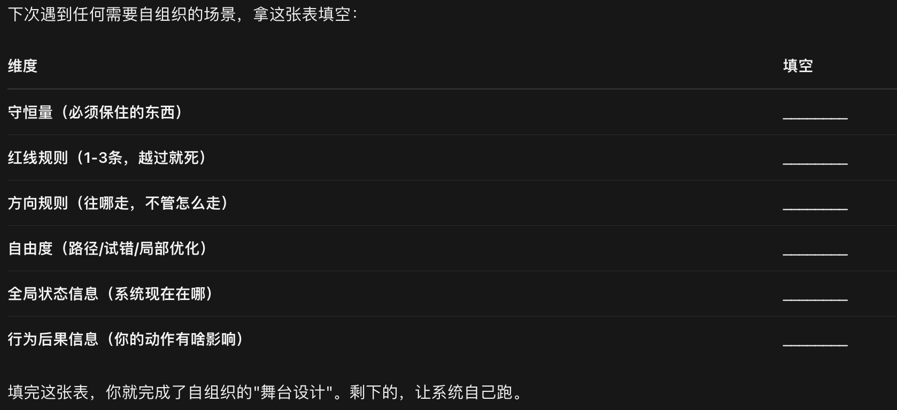

[todo 多种系统论书籍]
# 系统的定义与三要件
系统不仅仅是要素的集合，它由三要件构成：要素（Elements）、连接（Interconnections）、目标（Purpose）。
要素：系统的参与者或组成部分（如人体的细胞、公司的员工）。
连接：要素之间如何互动（如信息流、资金流、物理联系、规则）。
功能/目标：系统存在的理由或行为导向（注意：目标不一定是嘴上说的，而是系统实际呈现的行为趋势）

## 第一性原理内核：目标与连接，远比要素更重要。
只要连接和目标的内部结构不变，即使换掉所有要素，系统依然能保持原样运行；反之，如果目标变了，系统就彻底变了

结构决定行为:系统的行为模式不取决于要素的好坏，而取决于要素间的连接方式和系统目标。遇到问题先问：“这是人的问题，还是结构和规则的问题？”（通常是后者）
# 系统的骨架——存量与流量
核心内容：系统是如何在时间的维度上运作的？
存量（Stock）：在某一时刻存在的、被累积的量（如水库的水、你的存款、身体里的脂肪）。
流量（Flow）：导致存量变化的、随时间推移的速率（如流入水库的河水、每月工资/开销、饮食摄入/代谢消耗）

存量像是一个“蓄水池”，流量则是“水龙头”和“排水管”。存量调节着系统的稳定性，并对变化产生延迟（Lag）

## 第一性原理内核：存量是系统的记忆，流量是系统的动作。
系统的现状是过去所有流量的“积分”结果。改变存量需要时间（[延迟]），这就是为什么系统不会瞬间响应你的调整。
存量是时间的积分,所有肉眼可见的结果（财富、健康、关系）都是存量；你只能控制流量，不能直接控制存量。想要改变结果，别死盯结果，去调整流入和流出的“水龙头”。

# 系统的动态密码——反馈回路
核心内容：系统如何感知自身状态并做出反应？
反馈回路是连接存量、流量和信息的闭合环路。当系统的存量信息返回来影响流量的大小时，就形成了反馈。
平衡回路（Balancing Loop）：试图让系统保持稳定（如 thermostat 恒温器）。
增强回路（Reinforcing Loop）：让系统偏离原有状态，呈指数级增长或崩溃（如复利、谣言传播）。

## 第一性原理内核：线性因果是错觉，循环因果才是系统的真相。
在系统中，因会产生果，而果又会通过信息链回过头来影响因。没有绝对的因，也没有绝对的果；因会增强或抑制因自身，形成回路。
看到坏现象，别急着甩锅给某个“罪魁祸首”，寻找那个让坏事持续存在的闭环。

# 第一章
## 总体大于部分之和
内容：系统不是要素堆砌，而是一组相互连接的要素、为实现某个目标组成的整体；具有整体涌现性，可表现适应、动态、目的寻求、自保护甚至演进行为。

生活案例：一支篮球队不是5个高分球员相加——传球习惯、防守沟通、战术目标决定胜率；换两人若打法不变，整体风格仍稳定。

记忆点：拆开看零件会误判，合起来看连接才懂系统。

### 第一性原理：整体行为≠各部件行为相加；看系统要看“关系网”，不看“零件清单”

## 从关注要素到透视游戏规则
内容：系统三要件——要素、连接、功能/目标。要素常最显眼（人、设备、部门），但连接（信息流、资金流、规则）和目标更决定行为；目标要从实际行为推断，不从口号判断。

生活案例：家里总为家务吵架，换谁做都吵，本质是“分配规则+对公平的目标定义”有问题；定清楚谁、何时、做到什么标准，比换配偶/换保姆管用。

记忆点：别盯“谁在打球”，盯“按什么规则打、为什么打”。

### 第一性原理：重要性排序≈目标＞连接＞要素；换人常无效，改规则/改目标才改系统。

## 理解系统行为的动态性（存量与流量）
内容：存量是某时刻可观测、可计量的积累（存款、库存、体重、水位）；流量是一段时间内改变存量的速率（收入/支出、进/出水、摄入/消耗）。存量变化慢，起缓冲、延迟、减震作用；动态平衡即流入=流出。
记忆点：调结果调不动，调“进水/排水”才动；存量慢变要有耐心。
### 第一性原理：你只能直接调流量，存量只是流量的“时间积分”；存量越大，系统越不轻易变向。

## 反馈：系统是如何运作的
当存量变化回过头影响自身流量，就形成反馈回路；系统可自我维持、自我修正或自我放大。
记忆点：遇事别问“谁干的”，先画“谁让这事持续干”

### 第一性原理：因果是环不是链；A影响B，B常又影响A

## 调节回路
调节回路趋向目标或某个范围，抵抗偏离，是稳定来源，也是“抗拒变革”的来源（比如系统总想把改革拉回原状）

### 第一性原理：凡是“回到设定值”的机制，都是调节回路；太强则僵化，太弱则失稳。

## 增强回路
增强回路放大原有方向，形成良性循环或恶性循环，可指数增长也可加速崩溃；但受资源、限制或调节回路终结，不会无限跑

### 小差异被自我复制放大；早期介入最便宜，后期会失控

# 第二章
第一性原理：系统的复杂性是“连接数”和“延迟”的非线性函数，而非“零件数”的线性函数。
从单存量到双存量，零件数只增加了1个，但连接数增加了数倍，行为模式从“静态/单调”跃迁到了“动态/振荡”。
这揭示了一个深刻的真理：要理解复杂世界（如经济周期、生态崩溃），不需要寻找复杂的“要素”，只需要观察简单的存量之间是如何通过延迟相互连接的。
(性格不一定很复杂,但是在社交系统里就会显得行为复杂,找到那个人行为的锚点,破解这个人)
这就是“系统大观园”的底层逻辑——[简单规则生成复杂行为]

[公理1（积累公理）：世界由存量构成，存量随时间积分而生]

[公理2（反馈公理）：流量由存量通过信息连接调节，分为增强与调节两类]

[公理3（耦合公理）：多个存量通过流量交叉连接，形成网络；连接的复杂度和延迟决定了系统的动态模式]

[公理4（涌现公理）：当 N > 2（存量数量大于等于2）且存在交叉反馈延迟时，系统的宏观行为（如振荡、混沌）无法从单个存量的微观行为中线性推导，而是涌现（Emergence）的结果]

从这四个公理出发，我们可以逻辑地推导出：
单存量系统（N=1）只能产生增长、衰退或均衡（无振荡）。
双存量系统（N=2）必然能产生周期振荡（振荡是双存量系统的“自然态”）。
任何试图用“单存量思维”（如只看GDP增长，忽略环境存量）去治理“双存量系统”（经济-环境耦合），必然导致政策失效或系统崩溃（因为忽略了交叉延迟和振荡）
## 单存量系统
单存量系统是指系统中只有一个积累变量（存量），以及与之相关的流入量和流出量

行为模式：
无主动反馈：流入/流出固定，存量线性增减（如水龙头开固定角度，排水口塞住）。
调节回路主导：流出量随存量增加而自动增加（如浴缸有溢流管，水位越高排水越快），系统趋向动态均衡。
增强回路主导：流入量随存量增加而自动增加（如复利，本金越多利息越多），系统呈现指数增长或崩溃。
S型增长：同时包含增强回路（初期增长）和调节回路（后期资源限制），形成S型曲线（如人口增长受食物限制）。

### 第一性原理:存量是时间的积分，流量是存量的导数；反馈回路是流量的方向盘
单存量系统的所有行为，本质上都是流入与流出在时间维度上的积分结果。系统的未来状态完全由当前的存量水平和流量函数决定。没有存量，就没有记忆；没有反馈，
就没有自我修正或自我强化。单存量系统揭示了“结构决定行为”的最简形态——只要改变流量与存量之间的连接函数（反馈规则），就能彻底改变系统的行为轨迹。

## 双存量系统
世界的复杂动态，不需要复杂的零件，只需要简单的零件以复杂的方式连接。

双存量系统是指系统内有两个相互连接的存量，它们通过流量耦合在一起
基础模型：如两个相连的水库（A的出水是B的进水）、劳动力市场（劳动力存量与职位空缺存量）、捕食者-猎物模型（兔子存量与狐狸存量）。
行为模式：
级联传递：一个存量的变化通过流量滞后地影响另一个存量（如生产订单积压影响成品库存）。
耦合振荡：两个存量通过交叉的增强与调节回路相互影响，产生周期性的此消彼长（如兔子多→狐狸多→兔子少→狐狸少→兔子多，形成极限环振荡）。
非线性与混沌：在特定的参数下，双存量系统可能表现出对初始条件极度敏感的混沌行为

### 第一性原理：两个存量的耦合，创造了时间与空间的相位差，从而将简单的均衡转化为周期性的生命节律
双存量系统的本质是“互为因果的闭环”。单存量系统只能“自我对话”（存量影响自己的流量），而双存量系统开始“社会对话”（存量A影响存量B的流量，B又影响A的流量）。
这种交叉反馈加上时间延迟（A的变化需要时间才能改变B，B的改变又需要时间回馈给A），必然导致系统行为出现超调（Overshoot）和振荡。这是所有复杂生态、经济周期最底层的数学结构。

# 第三章
## 适应力（Resilience）
### 第一性原理
适应力 ∝ 回正映射的吸引域大小 + 冗余度。系统之所以是它自己，是因为有东西死活不变；适应力就是"保住这个不变"的动力学。
适应力是一套动力学：允许系统内部状态波动，但守住[系统存续这个核心不变]。系统表层可以变、可以被扰动，但是系统本身不会解体、崩溃
这个东西在系统动力学里叫：[系统的主导目标（系统目的）]

公理 1：任何持续存在的系统，都存在一个参考目标（不变锚点）；平衡回路会持续把系统状态拉回锚点附近。
公理 2：表层状态 ≠ 核心锚点。表层可以来回波动，锚点才是系统拼命要守住的东西。
公理 3：识别锚点，不能听系统里的人嘴上说什么，要看系统行为长期往哪个方向回归（行为优先于宣言）。

锚点不一定是写下来的规则，很多系统锚点是隐性的、自发形成的（社群、感情、职场圈子大多是隐性锚点）

适应力，建立在平衡回路之上。平衡回路负责把系统拉回锚点（维持核心不变）；适应力还额外要求系统有多条冗余的平衡回路。
如果只有单一条平衡回路维持锚点：锚点能稳住，但适应力差。这条回路一旦断了，系统直接崩盘。
如果有多条冗余平衡回路一起守护同一个锚点：这才是高适应力系统。一条回路失效，别的回路顶上，依旧守住锚点

### 4 步识别系统里 “保持不变” 的动力
#### Step1：给系统施加扰动，观察回弹方向（最核心方法）

方法：人为或者自然发生一个外部冲击，把系统从当前状态推开。看系统接下来会怎么变化：
如果扰动过后，系统自动回到原来的位置 → 这个位置就是锚点。维持回弹的反馈回路，就是保持不变的动力。
如果扰动之后，系统再也回不去，直接滑向新状态 / 解体 → 原来那个不是锚点，只是临时状态。

例子套到你之前的交友圈子：
圈子现状：大家互相表达好感，哪怕对方有伴侣，也可以暧昧开玩笑。
扰动事件：你严肃提出边界，要求停止对你对象的暧昧话术。
观察回弹：对方回复 “你想多了”，继续维持原来的暧昧表达。

👉 结论：
这个圈子隐性锚点：自由表达好感，暧昧只是玩笑，不需要严格为有伴侣的人避嫌。
维持这个不变的动力：圈子里大家默认的社交反馈，谁较真谁是问题。
哪怕你提出异议，系统会把状态拉回原有模式。
如果扰动之后，所有人立刻自觉避嫌，长期保持边界，那锚点就是 “尊重伴侣，保持社交距离”

#### 区分：负反馈回路 = 维持不变的动力；正反馈 = 放大变化（破坏稳定）
负反馈（稳定动力，维持锚点）：状态偏高 → 压低；状态偏低 → 抬高。目标：抵消扰动，回归锚点。这就是 “保持不变” 的动力学。
例：人体体温、公司成本管控、健康亲密关系里的矛盾修复机制。

正反馈（放大变化，不维持不变）：偏离之后，继续往同一个方向越走越远，不会回弹。正反馈会摧毁稳定。
例：雪球越滚越大、谣言扩散、持续升级吵架、亏损加仓越亏越多。

一句话：找维持不变的动力，本质就是找到系统里的负反馈回路，以及它瞄准的目标锚点。

#### 剥离 “口头宣称目标”，看行为锚点（很多系统心口不一）
很多组织 / 人 / 社群嘴上锚点和实际锚点是两套：
社群嘴上说：尊重别人的伴侣，保持社交边界。（宣称目标）
实际行为：有人越界，大家打哈哈，指责吃醋的人想多了。（真实锚点）

系统的真实目标，永远写在长期行为里，不是宣言。

#### 测试锚点的刚性：要多大冲击才能改变锚点？
锚点保住（系统不解体），允许表层波动；但如果锚点本身是有害的，强稳定反而会困住你

## 自组织（Self-organization）
给简单规则、自由度和信息，系统能涌现出新的结构,
自组织 = 连通的状态空间 + 不可线性分解的交互 + 计算不可归约性
自组织是最高级的设计，只不过设计的不是"结果"，而是"生成结果的土壤"

### 规则管"边界"和"方向"（保命+不跑偏）
自由度给在"路径"和"方法"上（怎么走自己选）
信息给"全局状态"和"行为后果"（让每个人知道系统在哪、自己的动作有啥影响）

规则的作用是防止系统崩溃和防止偏离身份（守恒量）。所以规则只需要定义两样东西:
1. 红线（底线规则）——"什么绝对不能做"
   判断标准：问自己——"如果所有人都这么做，系统还能存在吗？"如果答案是"不能"，那就是红线，必须写成规则。

2. 方向（目标规则）——"往哪个大致方向走"
   判断标准：问自己——"这条规则是在规定'做什么'还是'怎么做'？"如果是"怎么做"，删掉，那是自由度该管的事。

### 自由度的作用是让系统能探索状态空间
给自由度的地方，就是你说"我不知道最优解是什么，你们自己跑出来给我看"的地方。

自由度该给的三个区域：

1. 路径自由度——"怎么到达目标，你们自己选"
   团队：目标定了，谁做什么、什么顺序、用什么工具，自己定。
   个人成长：目标（比如"今年要提升沟通能力"），但报什么课、找什么人练、怎么练，自己试。
   投资：策略框架定了，但具体买卖时机、仓位分配，自己判断。

2. 试错自由度——"可以失败，失败成本低"
   谷歌20%时间、字节的"大力出奇迹"试错文化——允许浪费，因为探索空间需要冗余。
   个人：副业可以亏点钱、学新技能可以半途而废——这些都是"状态空间探索的门票"。

3. 局部优化自由度——"你们那个小模块，你们最懂"
   底层子系统（层次性）拥有自组织权。一线员工比CEO更懂客户，让他们自己调。
   判断标准：问自己——"这件事，我比一线的人更懂吗？"如果答案是"不"，那就是该给自由度的地方。

### 信息的作用是让反馈回路能工作。没有信息，要素就是瞎子，自组织变成乱撞。
必须给的两类信息：

1. 全局状态信息——"系统现在在哪"
每个参与者都需要知道系统的整体健康状况，否则他们的局部决策会互相踩踏。

2. 行为后果信息——"你的动作对系统有啥影响"
让每个人能看到自己的决策如何反馈到系统里，形成闭环。

## 层次性（Hierarchy)
层次性是信息压缩的必然产物，与权力、管理哲学完全无关——它是通信复杂度最小化的数学结果
分层就是信息压缩，接口越简越稳

### 如何分层是真正做到了信息压缩而不是流程太长？如何得知一个分层是否合理?
#### 本质区分：压缩 vs 传声筒

好的分层（真压缩）：
下层给上层的不是"全部细节"，而是摘要——几个关键数字、一个状态、一个判断。
上层看到摘要，就能做出正确决策，不需要知道细节。
信息量确实减少了：H(上层) << H(下层)。

坏的分层（假压缩/流程太长）：
下层把全部细节原封不动往上递，上层看完再往下传指令。
这层人没有做"粗粒化"，只是做了"转发"。
信息量没变：H(上层) 约等于 H(下层)，只是多了延迟

一句话区分：
真分层 = 信息变少了，决策变快了。
假分层 = 信息没少，只是多了一道手，变慢了。

#### 判断分层合理性的五个测试
测试1:压缩比测试
判断标准：如果上层需要看下层的原始数据才能做决策，说明这层没起到压缩作用——要么换人，要么取消这层。

测试2:自治率测试
下层能不能不请示上层，自己解决80%以上的问题？
判断标准：如果下层90%的决策都需要上层点头，那这层不是"管理层"，是"瓶颈层"。

测试3:延迟测试
判断标准：如果一个问题从发生到被最高决策者知道，超过一个决策周期，层级就太多了。比如市场变化以周为单位，但信息传到CEO要一个月——这公司必死。

#### 如何设计"真压缩"的分层
好的分层不是"多设几道关卡"，而是每一层只负责一个抽象层级的问题：

第3层（战略）：我们要不要做这件事？（方向）
↓ 输出：目标 + 资源
第2层（战术）：我们怎么做成这件事？（路径）
↓ 输出：计划 + 分工
第1层（执行）：具体动手做。（动作）
↓ 输出：结果 + 异常反馈

#### 实际操作会遇到一个问题，动手的人也需要了解上级的战略和战术，才能更好的行动，怎么解决这个问题?

纯粹的信息压缩（只给目标+边界）会让执行层变成"瞎子"，纯粹的信息透明（啥都告诉）又会把执行层变成"纠结症患者"。

这不是你的理解有误，而是层次性本身自带一个张力（Tension）：

上层需要压缩（为了决策效率），下层需要上下文（为了行动质量）。

怎么解这个矛盾？答案是：区分两条完全不同的信息通道

关键洞察：
战略意图是"广播"，不是"接口"。它不需要压缩，因为它不是"上报/下达"的指令，而是"共享的背景知识"。
压缩只压缩"工作交接的流量"，不压缩"认知的背景"

公理1（对齐公理）：执行层的行动质量 ∝ 对系统全局状态的认知度 × 自组织自由度。
如果只给自由度不给认知 → 瞎干（乱撞）
如果只给认知不给自由度 → 执行机器（无自组织）

公理2（通道分离公理）：战略信息（Why/What/Constraint）走广播通道，不计入接口带宽；状态/决策信息（How/Status）走接口通道，受压缩约束。
两条通道互不占用带宽。战略透明不会让接口变胖。

公理3（接口极简公理）：无论下层多懂战略，向上汇报时依然只传摘要+异常；向下指令时依然只传目标+边界。
懂战略 ≠ 需要多汇报。汇报量不变，但行动质量变了。

推导：
当上下文通道全开（战略透明）+ 接口通道极简（压缩汇报）时，系统同时获得高行动质量（因为理解Why）和高决策效率（因为接口瘦）。
这是唯一不牺牲任何一方的设计。

#### 操作指南：战略怎么给，接口怎么简
一、战略给什么（广播通道，不压缩）

给执行层三样东西，用大白话讲清楚，不需要保密，全员可见：

1. Why（为什么做）
   不是"公司战略是成为行业第一"这种空话
   是"我们为什么要做这个项目"——客户的痛点是什么？市场机会在哪？不做会怎样？
   让执行层理解自己在解决什么真问题，而不是"老板让我干啥我就干啥"
2. What does good look like（成功长什么样）
   不是KPI数字
   是"做完之后，用户/客户/公司会变成什么状态"
   让执行层有判断标准——遇到岔路时知道往哪拐
3. Constraints（边界/红线）
   时间、预算、法律、道德、技术限制

二、接口怎么简（压缩通道，点对点）

即使执行层完全懂战略，上下级之间的工作交接依然遵循压缩原则：

下层 → 上层（上报）：
正常情况：只报"状态（正常/预警/危险）+ 需要上层做什么（资源/授权/不管）"
异常情况：报"发生了什么 + 已采取什么措施 + 需要什么支持"
不需要：解释为什么这么做（因为上层知道Why）、汇报过程细节（上层不关心）

上层 → 下层（下达）：
只给"目标调整 + 新边界 + 资源变化"
不给：微观指令（因为自由度在那）
大白话：战略是"地图"（人人都有），接口是"电报"（有事才发，字越少越好

下次带团队/管项目/甚至教孩子，用这个模板发"战略包"：

我们在解决什么问题：________

做成什么样算成功：________

不能踩的线：________

你们自己决定的是：________（路径/方法/分工）

需要我支持时怎么找我：________（异常才报）

填完这五条，战略透明了，自由度给了，接口还是压缩的。

# ai提示词
当你面对任何复杂问题（如项目停滞、家庭矛盾、个人成长瓶颈）时，拿出纸笔问自己四个问题：
找目标：这个系统（或这件事）真正的目标是什么？（注意实际行为，而非口号）
拆结构：里面的关键要素有哪些？它们之间是怎么连接的？（信息怎么流？钱怎么流？）
画存量：我关心的那个核心结果（存量）是什么？影响它的流入量和流出量分别是什么？
查回路：有没有什么反馈机制在起作用？是让事情越来越稳（调节），还是越来越疯（增强）？调整之后要等多久才会见效（延迟）？
