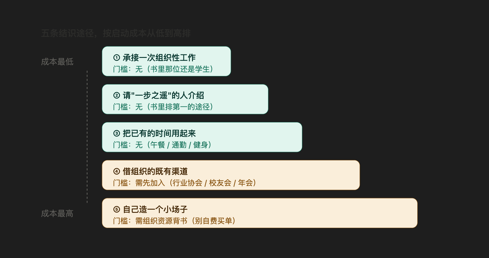

# 第一性原理
每个人都有时间和精力这两种资源，要利用这些资源来建立权力，一个简单而有效的方式就是，做一个好的倾听者，提些和对方有关的问题。如果你没有太大的权力，很可能你就有时间。利用这些时间去善待他人，参与对他们而言很重要的事情

小事情也非常重要，比如参加生日聚会、葬礼、跟能够帮助你的人共进午餐，在他们或他们的家庭成员生病的时候前去探望
做小事也可以让你获得权力，因为人们往往懒于做那些看似微不足道的事情，或是对它们不感兴趣。因此，如果你主动做些相对不太重要的事情，
而且做得非常好，就不太可能有人会和你争抢这样的机会。同时，这些显得不重要的事情可能会成为权力的重要来源

获得地位的一种方法是创建这样一个组织：它的使命如此引人注目，以至于可以吸引地位较高的人士来参与，这样你就不仅确立了地位，也建立了与重要人物的人际关系

地位等级是稳定的，组织和人员不仅难以向上移动，而且也很难向下移动。一旦你通过关系网获得了权力和地位，你就能保持你的影响力而不需花费太多时间和精力。
你可以利用你的高等级人际关系网络来赚钱。

权力和影响力不只来自于广泛的人际关系网络和成员较高的社会地位，也来自你自己在人际关系网络中所处的位置：处于网络关系的中心非常重要。
在部门中处于能够控制信息传播的位置上，对于晋升特别重要。如果所有的信息都会经过你，你就会有更多的权力。你的权力来源之一在于你对信息流的控制，
而另一个来源则是，其他人认为处于人际关系网络中心位置的人拥有权力。如果所有的信息都会经过你，你就会有更多的权力。

在一个人际关系网络中，中心位置带来了权力，但同样重要的是通过链接不同的网络来获得权力。大多数人倾向于和自己相似的人联系，即所谓的“趋同原则”。
因此，有些群体本来可以从与其他群体的交往中获得好处，但他们却没有这样做，因为群体成员在内部进行交往会感到更舒适自在。

有些群体之间在本质上具有紧密联系，但在社会上却相互隔离，有些人将这样的两个群体连接起来，成为帮助这两个群体往来的中介，而他们可以从中获益。

一个弱联系的大型网络对创新和寻找信息有利，而紧密联系的小型网络更适合于利用现有的知识和转化隐性技能

领导的实质就是：让拥有不同能力和视角的人或部门协作，共同完成一项任务或达成一桩交易。

发展人际关系的两个最重要行为是“维护外部联系”和“建立内部联系”

帮助对手调动到另一个组织，这样他们就不会阻挡你的道路，可能这不是你计划要做的首要大事，但你也应该把这件事排在计划中靠前的位置
# 清单法


[潜规则11问] (https://docs.qq.com/aio/DV3pBQ3FIS2RYRVNv?AIGenerate=1&openAiAssistant=1&yb=1&p=dDWnvdTJpUKPF5HHZ4h3oP)

# 权力的定义

# 《权力：为什么只为某些人所拥有》全书精读（v2）

> 作者：杰弗瑞·菲佛（Jeffrey Pfeffer，斯坦福大学组织行为学教授）
> 中文版：中国人民大学出版社·湛庐文化｜英文原版 *Power: Why Some People Have It and Others Don't*（2010）
>
> 本文覆盖四项内容：**① 第一性原理（7 条公理）　② 协作链路分析　③ 逐章内容与小节精读　④ 反常识签名与批判边界**
>
> **v2 与 v1 的差异**：v1 把全书读成「一条串联的因果链」；v2 补上更准确的一层——**全书其实是三条并行线路的协作**，且每章、每小节都在承担明确的分工。v2 新增：作者—读者协作契约、三线并行模型、章间交付-依赖矩阵、章内小节编排语法、七组跨章互文镜像。
>
> 全文基于原文（约 15.7 万字符）与已蒸馏的 22 张能力卡写成，术语统一见 `GLOSSARY.md`。

---

## 零、一句话与一个公式

**一句话主旨**：权力不是被授予的，而是争来的——它由「业绩之外的七件事」共同决定（被看见、被记住、掌握资源、经营关系、表演、声望、防守），因此是一门**可学、可练、必须主动争取**的技能。

**核心公式**：

> **权力 = 意愿（雄心 · 精力 · 专注）× 技能（自知 · 信心 · 换位 · 化解冲突）**
>
> **影响力 = 业绩 × 可见度 × 关系位置 × 形象声望**，再减去 **成本**、乘以 **防守**。

---

## 一、第一性原理：7 条公理

菲佛的书表面是案例集，剥到最里面只有少数几条不可再分的东西在反复发力。**接受它们，一长串行动就是逻辑必然；违反它们，背再多技巧也会失效。**（详细推导见 `第一性原理实践手册.md`）

| # | 公理 | 内核 | 主要来源章 |
|---|---|---|---|
| 一 | **权力争得律** | 权力是争来的、可习得，与职位天赋可分离；**智力不在主要变量里**（与收入相关性约 0.2） | 序言、2 |
| 二 | **非业绩结算律** | 业绩是**入场券**不是**计分板**；评价被「评价者 · 标准 · 你与评价者的关系」三者污染 | 1 |
| 三 | **可见律**（印象先于事实） | 被记住就等于被选择；印象形成极快（11 毫秒）、极持久，且**自我实现** | 4、8 |
| 四 | **结构律** | 关系的力量来自**结构位置**而非亲密度；弱联系优于强联系、结构洞、网络中心 | 6 |
| 五 | **表演律**（行为反向塑造态度） | 别人看不到你的内心，只看到你的举止；**先演，后成为**——全书见效最快 | 7 |
| 六 | **正期望交换律** | 请求与善意的期望值为正；人系统性高估被拒概率，低估对方说「不」的成本 | 4、5 |
| 七 | **成本与熵增律** | 权力有成本且会自动流失；**最大的敌人是权力对拥有者的改造** | 10、11 |

> 这 7 条与「零」中的公式共同构成本书的**第一性原理层**。后文每一章、每一小节，本质上都是在为其中某一条提供证据或操作手段。

---

## 二、协作链路分析 ★

> 这是本文的核心。**一本好书不是章节的堆叠，而是一次分工明确的协作**——作者与读者协作，章节与章节协作，小节与小节协作。下面分七个层面拆开。

### 2.1 作者与读者的协作契约

菲佛在全书设置了 **3 道通行证**。读者不先签下它们，后面的方法论就全部读不进去——这是作者强制性的前置条件，也是本书与普通「职场技巧书」最大的差别：

| 通行证 | 契约内容 | 设置位置 | 不接受的后果 |
|---|---|---|---|
| **① 世界不公正** | 承认业绩不会自动兑现 | 序言 + 第 1 章 | 会把后面全部内容读成"歪门邪道" |
| **② 我可以被改造** | 承认「我不擅长」是自我设限而非事实 | 第 2 章 | 第 3–8 章的六步路线图将无人可执行 |
| **③ 分歧值得处理** | 承认回避冲突是不负责任 | 第 9 章 | 一旦遇到阻力就退出，前面全部作废 |

**协作的含义**：作者先要读者**放弃三个舒适信念**，才愿意交付工具。这也解释了为什么本书前两章几乎没有可直接执行的动作——那两章的功能不是"教你做事"，而是"换你的世界观"。

### 2.2 宏观协作：五段接力

四大部分 + 序言，构成一次完整接力，每一棒都有明确的交接物：

| 段 | 位置 | 角色 | 交付物 | 交给谁 |
|---|---|---|---|---|
| **破** | 序言 | 立项 | 问题定义 + 三大障碍 | 第一部分 |
| **立** | 第 1–2 章 | 换认知 / 备装备 | 破除业绩幻觉、给出「意愿×技能」 | 第二部分 |
| **打** | 第 3–8 章 | 六步进攻 | 选址→进场→资源→关系→表演→声望 | 第三部分 |
| **守** | 第 9–11 章 | 防御与核算 | 冲突 → 成本 → 失权 | 第四部分 |
| **行** | 第 12–13 章 | 落地 | 行动理由 + 环境选择 | 读者 |

> **协作特征**：这是一次**严格的前置依赖接力**——不完成「破」，就不会认同「立」；没有「立」的装备，第二部分无从执行；不看清「守」的代价，第 12 章的动员就是廉价的鸡汤。

### 2.3 中观协作：第二部分的「三线并行 + 一汇合」★

**这是 v1 漏掉、也是最重要的一层。** 第 3–8 章表面是六步串联，实际上是由**三条并行线路**组成，它们从不同侧面攻击同一个目标——「提升影响力」，最后在「声望」处汇合：

```
                    前提：序言 + 第 1 章（拆掉业绩幻觉）
                              ↓
                    引擎：第 2 章（意愿 × 技能）
                              ↓
        ┌─────────────────────┼─────────────────────┐
        ↓                     ↓                     ↓
   【结构线】            【资源线】            【感知线】
   你站在什么位置         你手里握着什么         别人怎么看你
   第3章 选址            第5章 资源            第4章 可见度
      ↓                     ↓                    ↓
   第6章 关系             （可凭空创造，         第7章 表演
  （弱联系/结构洞）        故只有一章）            ↓
        └─────────────────────┼─────────────────────┘  第8章 声望
                              ↓                    （三线在此汇合）
                        防守：第 9 → 10 → 11 章
                              ↓
                        落地：第 12 → 13 章
```

**为什么第 5 章只有一章？** 因为资源线的最佳策略不是"积累"而是"创造"——书里的原话是「第一个创办会议的人，自然而然获得了垄断权」。资源可以凭空造出来，所以它不需要层层递进，而是一次性给到一个高杠杆动作。**这是三线中唯一"短而陡"的一条。**

**三线的独立性**：任何一线单独推进都能产生效果，但只有三线同向，声望才会稳定（第 8 章）。这也是为什么第 8 章排在六步之末——它是**汇合点**，不是第六步。

### 2.4 章间协作矩阵：每章交付什么、依赖谁

把 14 个单元看作项目团队，每章都有明确的**交付物**与**上游依赖**：

| 章 | 团队角色 | 交付物 | 上游依赖 | 下游消费者 |
|---|---|---|---|---|
| 序言 | 立项 | 问题定义、三大障碍 | — | 全书 |
| 01 | 诊断 | 破除业绩幻觉（非业绩结算律） | 序言 | 2、4、5、6、8 |
| 02 | 装备 | 权力 = 意愿 × 技能；7 大特质 | 01 | 3、7 |
| 03 | 选址 | 部门权力 3 要素（结构线起点） | 02 | 04、06 |
| 04 | 进场 | 可见度（感知线起点） | 03 | 08 |
| 05 | 供给 | 资源创造（资源线全部） | 04 | 06、08 |
| 06 | 组网 | 社会资本策略（结构线主干） | 03、05 | 07、08 |
| 07 | 表现 | 演 6 原则 + 说 3 策略（感知线主干） | 02、06 | 08 |
| 08 | 固化 | 声望工程（**三线汇合点**） | 04、05、06、07 | 09、12 |
| 09 | 防御 | 冲突 8 律 + 反败为胜 3 策略 | 08 | 10 |
| 10 | 核算 | 权力 5 大成本 | 09 | 11 |
| 11 | 预警 | 失权 6 因素（保权能力卡） | 10 | 12 |
| 12 | 动员 | 「等级无处不在」的行动理由 | 11 | 13 |
| 13 | 落地 | 环境选择 + 不交出权力 | 12 | 读者 |

**读法**：「下游消费者」一列就是这本书的**目录导航**——第 1 章之所以重要，是因为它被 5 个章节同时引用，是全书的**地基**；第 8 章之所以重要，是因为它汇总了四条上游线路的全部分工成果。

### 2.5 章内协作：小节的「破 — 法 — 器 — 界」编排语法

菲佛写每一章内部的多个小节时，几乎遵循同一套语法，**四个功能位**按序排布：

| 功能位 | 作用 | 典型小节名 |
|---|---|---|
| **破** | 先推倒一个常识，制造认知张力 | 「重要的不只是业绩」「最熟悉的不一定是最适合的」 |
| **法** | 给出可操作的方法骨架 | 「衡量部门权力的 3 大要素」「发展关系需要的不是时间，而是规划」 |
| **器** | 给具体清单或工具，可直接照做 | 「7 大特质」「演出权力的 6 大原则」「应对冲突的 8 条金律」 |
| **界** | 给边界与警告，防止用歪 | 「别让聪明埋下溃败的种子」「克服自我宣传的困境」「谁说负面信息都是有害的」 |

**注意「界」的位置**：它几乎总是出现在**章末**。作者从不先讲警告，而是**先让你心动，再给你护栏**——这是一种刻意的说服顺序。知道这一点，读者就能主动在「器」之后回看「界」，避免只记住清单而忘记红线。

### 2.6 跨章互文：七组镜像呼应 ★

全书有若干组**相距很远但讲同一件事**的段落，它们互为镜像。发现这些呼应，是理解"协作"最直观的方式：

| 组 | 章 A | 章 B | 呼应内容 |
|---|---|---|---|
| 1 | 第 1 章「恭维，一份美妙的礼物」 | 第 6 章「尽可能善待他人」 | **同一机制（互惠规范）的两种用法**：一个是言语给予，一个是实质给予 |
| 2 | 第 4 章「可见度」 | 第 8 章「声望」 | **被注意到 ≠ 被预期成什么**；前者是量，后者是质，且后者自我实现 |
| 3 | 第 2 章「信心：先演后成为」 | 第 7 章「演出权力的 6 大原则」 | 第 2 章给**原理**（认知失调），第 7 章给**操作**（姿势、愤怒、停顿） |
| 4 | 第 3 章「选址」 | 第 13 章「通往权力之路」 | **一头一尾**：进来时怎么选环境，离开时怎么选环境；都是"位置决定上限" |
| 5 | 第 5 章「离职即失权」 | 第 10 章「权力戒断」 + 第 13 章「身份锚外置」 | **暗线 B 的三次开火**：权力是借来的，别把它锚在职位上 |
| 6 | 序言「破除公正世界信仰」 | 第 13 章「不要期待公正」 | **暗线 A 的闭环**：开头拆掉假设，结尾确认它 |
| 7 | 第 1 章「出色的业绩可能会困住你」 | 第 11 章「时代变了，战术不变」（能力陷阱） | **同一个陷阱的两种形态**：业绩不可替代 → 被锁死；过去成功 → 路径依赖 |

> 第 5 组和第 7 组尤其值得注意：它们说明本书的"防守"部分（9–11 章）并非新增主题，而是把前面埋下的伏笔**收回**。

### 2.7 三条贯穿全书的暗线

明面上的「破立打守行」之外，全书还有三条反复出现的暗线，正是它们把 14 个单元缝成一个整体：

1. **暗线 A｜「认知 → 行为 → 现实」的自我实现循环**
   公正世界信仰（序言）→ 第一印象自我实现（第 8 章）→ 权力趋向 / 抑制（第 11 章）。
   核心都是：**你以为的世界，会变成你得到的世界。**

2. **暗线 B｜「权力依附于位置」的脆弱性**
   第 5 章「离职即失权」→ 第 10 章「权力戒断」→ 第 13 章「把身份锚放在组织之外」。
   反复提醒：**权力是借来的，随时会被收回。**

3. **暗线 C｜「反直觉」的方法论签名**
   弱联系优于强联系、表现愤怒优于悲伤、提要求的期望值为正、自吹不如让别人替你说……
   **作者几乎每一章都要推翻一个常识**（完整对照见 4.2）。

### 2.8 链路总述

> **先拆掉「世界是公正的」这个假设（破）→ 再承认权力可习得并备好特质（立）→ 然后沿「结构线（选址→关系）· 资源线（凭空创造）· 感知线（可见度→表演→声望）」三线并行推进（打）→ 同时把冲突、代价与失权当成必须管理的东西（守）→ 最后落到「选对环境、不交出权力、照顾好自己」（行）。**

**一句话概括协作**：**前两章换你的脑子，中间六章分三路给你武器，后三章教你付账，最后两章把你推出去。**

---

## 三、逐章精读（14 单元 · 含全部小节）

> 每章按「**定位 → 协作位 → 核心命题 → 小节逐一 → 关键案例 → 教训框 → 链路交接**」展开。小节名均照录原文目录。

### 【序言】权力是「争」来的，不是「等」来的

- **定位**：总纲，也是全书**前提层**——不先接受它，后面全部读不进去。
- **协作位**：**立项**。为全书定义问题、发放第一张通行证。
- **核心命题**：业绩不会自动带来权力；追逐权力与晋升、绩效、健康、财富**正相关**。阻碍人争取权力的是**三大障碍**：
    1. **对「公正世界」的信仰**——「好人有好报」是心理需要，不是事实；它让你学不到东西、也不设防。
    2. **成功者的领导力说教**——CEO 自传给的是「登顶后」的建议，且被自我展现修饰过（幸存者偏差）。
    3. **你自己（自我设限）**——「我不想要 / 我不擅长 / 我不屑于」是对自尊的提前保护。
- **关键案例**：安妮（商学院毕业、无技术背景，却凭组织政治能力成为初创公司领导者）——她不是最有资格的，却是最主动的。
- **链路交接**：立起**公理一**（争得律），预告**公理二**（非业绩结算）。交给第 1 章。

### 【第 01 章】业绩决定你的权力地位吗 —— 答：不

- **定位**：**拆掉最大的错觉**，全书反常识签名最浓的一章。
- **协作位**：**地基**。被第 2、4、5、6、8 章同时引用（全书引用度最高）。
- **核心命题（公理二）**：业绩是必要但不充分的；**评价权掌握在他人手里**。
- **小节逐一**：
    - **重要的不只是业绩**：鲁迪·克鲁拿了全国「年度最佳督学」，半年后被解职——衡量他的从不是学校业绩，而是"谁能拿到合同与就业机会"。**行为性承诺**说明评价被初判持续扭曲。
    - **别人记住了你，就等于选择了你**：单纯曝光效应（扎荣茨）——"被记住"往往压倒"被评价为最好"。
    - **让有利于你的业绩凸显出来**：业绩有很多面，你可以选择强调做得好的那面（蒂娜·布朗强调发行量与广告收入）。
    - **记住你的老板认为最重要的事**：把注意力对齐到**掌权者的计分板**，而不是你自认为的计分板。
    - **恭维，一份美妙的礼物**：让掌权者自我感觉良好是可靠的权力来源；查特曼试图寻找"恭维失效的临界点"，**却没有找到**。
- **关键案例**：LECG 的 CEO 业绩糟糕（股价两年跌 80%）却稳坐多年——靠"管理董事会的能力"与关系。
- **教训框**：①「只要让老板高兴了，业绩表现真的不重要」；②「出色的业绩可能会困住你」（菲尔/格伦达被"太不可替代"困住）；③「你必须关心你和你的老板之间的关系，至少不亚于关心你的工作业绩」。
- **链路交接**：结论"靠被评价" → 追问"但怎么被评价" → 交给第 2 章（装备）与第 4、6、8 章。

### 【第 02 章】打造你的权力特质

- **定位**：**装备层**——回答第 1 章的追问"那到底靠什么"。
- **协作位**：**引擎**。为第二部分的六步提供操作主体（"谁来做"）。
- **核心命题（公理一）**：权力可习得。**权力 = 意愿（雄心/精力/专注）+ 技能（自知/信心/换位/化解冲突）**；**智力被严重高估**。
- **小节逐一**：
    - **改变，没有什么不可以**：反驳"性格决定论"——"你学会滑雪了吗？滑雪是天生的吗？"
    - **你真的了解自己吗**：人受**自我增强**与**高于均数效应**影响，几乎无法客观自评——所以要**请别人给你打分**。
    - **7 大特质让你大权在握**：**雄心**（专注目标）、**精力**（会传染）、**专注**（放大镜效应，选一个行业待 5–10 年）、**自知之明**（用"前馈"代替"反馈"）、**信心**（先演后成为）、**换位思考**（读出他人利益，如约翰逊记住 99 个参议员各自的欲望与弱点）、**化解冲突**（在他人回避时挺身而出）。
    - **别让聪明埋下溃败的种子**：智力与收入相关性仅约 0.2；超过一定水平还会带来过度自信与麻木。
- **关键案例**：约翰逊的记忆式社交；康多莉扎·赖斯「如果你有权力并愿意使用，人们就会加入你这边」。
- **链路交接**：把"权力"从"天赋/运气"改写成"可训练的技能清单" → 交给第 3 章开始选址。

### 【第 03 章】起点决定高度（路线图第 1 步 · 选址 · 结构线起点）

- **定位**：**进攻第一步**——"从哪开始"。
- **协作位**：**结构线的起点**，并为第 13 章预留了"选环境"的伏笔。
- **核心命题**：部门权力是**结构性差异**，起点显著影响天花板。
- **小节逐一**：
    - **最熟悉的不一定是最适合的**：常识以为"进核心业务部门"最优；作者指出这往往是陷阱——核心部门竞争最激烈、路径最死板，且"今天最重要的功能，将来不一定仍重要"。
    - **衡量部门权力的 3 大要素**：① 相对薪酬；② 办公室位置与设施；③ 在委员会与高管层中的位置。部门权力来源于**凝聚力**（共同仪式、规范、信任纽带）+ **对关键资源的控制**。
    - **选择未知的风险还是激烈的竞争**：更优策略是进入**"尚未被充分开发利用、但未来会重要"**的位置——风险与回报的权衡。
- **关键案例**：富国银行高管多来自管理科学部门（部门凝聚力的力量）。
- **链路交接**：选址之后，"选好了，怎么进场" → 交给第 4 章。

### 【第 04 章】成为最引人注目的那一个（第 2 步 · 进场 · 感知线起点）

- **定位**：**进攻第二步**——"怎么进场、怎么被看见"。
- **协作位**：**感知线的起点**；同时也是全书与读者直觉正面冲突最激烈的一章。
- **核心命题（公理六 + 公理三）**：**提出要求**是正期望值动作；**请求即恭维**；招人喜欢 ≠ 获得权力。
- **小节逐一**：
    - **提出你的要求**：人们系统性**高估被拒概率**——因为他们只算"给对方带来的成本"，没算"对方说'不'的代价"（违反"乐善好施"规范、尴尬、错失施惠带来的权力感）。
    - **做引人注目的"基辛格"**：可见度是可经营的资源；"枪打出头鸟"是糟糕的职业建议。
    - **谁说招人喜欢就能获得权力**：人们用「友好」与「有能力」两轴评价你；在**资源分配场景**里，押注**能力/威慑**。⚠️ 详细辨析见 `权力的反常识判据手册.md`
- **关键案例**：基思·法拉奇——接受录用前坚持要见"头儿"。
- **链路交接**：被看见之后，需要"拿什么支撑" → 交给第 5 章（资源）。

### 【第 05 章】谁拥有资源，谁就有权力（第 3 步 · 资源 · 资源线全部）

- **定位**：**进攻第三步**——"拿什么"。
- **协作位**：**资源线的全部**，三线中最短最陡的一条（因为"资源可以创造"，不需要层层递进）。
- **核心命题**：资源 = 别人想要的或需要的东西（钱/工作/信息/支持/友谊/帮助）；**资源可以凭空创造**。
- **小节逐一**：
    - **尽可能善待他人**：互惠规范 + 人们不精确记账 → 小付出高杠杆。
    - **做重要的小事**：参加生日会、葬礼、探望病人——低成本、高回报的关系投资。
    - **积极寻找和利用资源**：权力与资源会带来更多权力与资源（自我强化循环）。
    - **创造属于你的独一无二的资源**："第一个创办会议的人，自然而然获得了垄断权。"
- **关键案例**：威利·布朗以"筹款—分给同僚"建立议长权力；海蒂·罗伊森的人脉变现。
- **教训框**：「对人友善会带来影响力，因为人们很难和殷勤有礼的人发生争执」；「当你离开一个可以控制庞大资源的职位时，个人的重要性和权力就丧失了」（**暗线 B**）。
- **链路交接**：资源之后，要问"靠谁放大" → 交给第 6 章（关系）。

### 【第 06 章】关系，永恒的王道（第 4 步 · 关系 · 结构线主干）

- **定位**：全书**最成体系**的一章（8 个小节），"社会资本"能力卡的来源。
- **协作位**：**结构线主干**；同时接收资源线（第 5 章）的输入——资源要靠关系放大。
- **核心命题（公理四）**：社会资本决定职业生涯；**弱联系优于强联系**；关系靠**规划**而非时间。
- **小节逐一**：
    - **什么是人际关系网**：主动建立、维护、使用非正式关系的行为。
    - **关系是组织成功的保证 / 是职业生涯发展优劣的重要决定因素**：社会资本是职业生涯成功的最强预测因子之一（有纵向研究验证）。
    - **人际关系技能是可以提升的**：不是"内向就没救"。
    - **发展关系需要的不是时间，而是规划**：列清单、排优先级、定期维护（如建一张"该联系谁"的表）。
    - **不是每个人的价值对你都一样**：区分谁拥有资源、谁掌握信息、谁能引荐。
    - **让自己成为人际网络的中心**：信息必经点 → 更好的绩效评级与更快的工资增长；位置可主动构建（甚至靠物理位置，如把办公桌放在合伙人办公室外）。
    - **为工作选择最适宜的人际策略**：按**隐性知识 vs 明确知识**选网络密度——需要隐性知识用小紧网络，需要创新用弱联系大网络。
- **关键案例**：格兰诺维特（弱联系找工作）、伯特（结构洞）、海蒂·罗伊森。
- **链路交接**：有了资源与关系，要问"怎么把它表现出来" → 交给第 7 章（表演）。

### 【第 07 章】权力是「演」出来的，也是「说」出来的（第 5 步 · 表演 · 感知线主干）

- **定位**：**全书见效最快**的一章，"权力表演术"能力卡的来源。
- **协作位**：**感知线主干**；同时把第 2 章埋的"信心：先演后成为"落成具体动作。
- **核心命题（公理五）**：**领导力的秘诀就是表演**——先演，后成为；行为反向塑造态度。
- **小节逐一**：
    - **领导力的秘诀就是表演**：三条原则——先表演（之后不再像表演）；情绪有传染性；情绪与行为会自我强化（格鲁夫：「部分在于欺骗，而欺骗会变成现实」）。
    - **"演"出权力的 6 大原则**：① 留意你的观众；② **表现愤怒，而非悲伤和悔恨**（泰登斯研究，⚠️ 对女性有额外代价）；③ 注意姿势和手势（笔直站立、向前迎、直视、手势简短有力）；④ 用记忆调动所需情感；⑤ 设置舞台与管理环境；⑥ 不必急于给出回应（呼吸、停顿、镇定）。
    - **"说"出权力的 3 大策略**：① **打断**（有权者打断别人）；② **质疑讨论的前提**（决定议程与互动规则，比赢下争论更深刻）；③ **语言有说服力**（唤起画面、三项列举、对比、"我们/他们"、不用笔记）+ 适度幽默。
- **关键案例**：奥利弗·诺斯的"让我说完"；尤伯罗思把老板会议改成"老师上课"。
- **教训框**：「通过分享笑话，你可以解除听众的防备。」
- **链路交接**：表演之后要留下**可持续的东西** → 交给第 8 章（声望）。

### 【第 08 章】建立自己的声望（第 6 步 · 声望 · 三线汇合点）

- **定位**：**进攻的收尾**，长期复利的一章，"声望与形象工程"能力卡来源。
- **协作位**：★ **三线的汇合点**。它不接收单一线路，而是汇总结构线、资源线、感知线的全部成果。
- **核心命题（公理三）**：声望 ≠ 成就；**声望创造现实**，且**先于业绩起作用**（"天才"沃尔什几乎不被解雇，胜率更高的马登却被迫辞职）。
- **小节逐一**：
    - **留下第一印象的机会只有一次**：11 毫秒形成的印象与不限时几乎一致；不足 30 秒的无声视频评分 ≈ 季度末学生评分。
    - **精心策划和树立你的形象**：四个过程（注意力下降 / 认知漠视 / 行为动力 / 偏见同化）让印象**自我实现**。
    - **特别重视你在媒体中的形象**：⚠️ 时代局限——以报刊/电视为核心，未覆盖算法分发时代。
    - **克服自我宣传的困境**：不宣传被认为无法胜任，自吹被认为傲慢；**第三解 = 让别人替你说话**（代理、公关、猎头、同事背书）。
    - **谁说负面信息都是有害的**：**打预防针**——战略性披露不致命的缺点（前提：与"别人选择你的理由"无关）。⚠️ 详见 `权力的反常识判据手册.md`
    - **形象创造现实**：正面的预期吸引资源与机会，成为自我实现的预言。
- **链路交接**：进攻完成，进入**防守** → 交给第 9 章（挫折）。

### 【第 09 章】挫折也是一种财富（防守 · 冲突与翻身）

- **定位**：**防守第一步**，"冲突应对"能力卡来源。
- **协作位**：**第二张通行证**（"分歧值得处理"）；同时收回第 8 章的声望成果，检验它在逆风中能否守住。
- **核心命题**：**分歧不可避免，回避分歧是不负责任**；关键在**先定义"胜利是什么样子"**。
- **小节逐一**：
    - **应对冲突的 8 条金律**：① 善待对手、给台阶下（逆反心理：压制遭反强制）；② 不给自己制造不必要的麻烦（先问"赢了包含什么"）；③ 与关键人物保持良好关系（到某层级，关系比你的感觉重要）；④ 坚持是胜利的前奏；⑤ 多条战线并进（用一个战场的声望反哺另一个）；⑥ 采取行动、抓住战机（别等）；⑦ 奖励朋友、处罚敌人（⚠️ 伦理边界）；⑧ 为你的目标找到强大的支持者（把目标挂在更高、更有社会价值的事业上）。
        - **内部张力**：第 1 律（善待对手）与第 7 律（惩罚敌人）看似矛盾——**善待用于"已结束的对抗"以降低长期敌意，奖罚用于"日常资源分配"以建立可信度**。
    - **反败为胜的 3 大策略**：① 不要躲、不要自责、尽快讲述；② 回到曾带来成功的事；③ 永远**表现得你会赢**。
- **关键案例**：桑迪·韦尔（屡遭拒绝却东山再起）；弗朗西斯·康利（唯一女性神经外科医生）。
- **链路交接**：撑过冲突之后，要面对"代价" → 交给第 10 章。

### 【第 10 章】为权力必须支付的 5 大成本（防守 · 代价）

- **定位**：**防守第二步**，全书最诚实的一章，"权力成本核算"能力卡来源。
- **协作位**：**收账**。它把第六步（声望）带来的"盛名"作为第一项成本收回——进攻有多顺，成本就有多实。
- **核心命题（公理七）**：争取权力不是纯收益，**要核算后再决定**。
- **小节逐一（即 5 大成本）**：
    - **成本 1：「盛名」之下的压力**：社会促进效应反而损害复杂/新颖任务表现；求稳倾向上升。
    - **成本 2：丧失自主权**：日程被别人填满，隐私被压缩。
    - **成本 3：牺牲家庭和个人生活**：⚠️ 对女性有额外代价（"两个人，一个职业生涯"）。
    - **成本 4：不是每个人都可以信任**：位置越重要，越需要警惕"听到的是不是真相"。
    - **代价 5：权力让人欲罢不能**：**权力戒断**——失眠、生病、失落，宾克利说这"几乎跟硬性戒毒没有什么不同"。
- **关键案例**：尼克·宾克利的权力戒断自述。
- **链路交接**：付了代价，要问"怎么别掉下来" → 交给第 11 章（失权）。

### 【第 11 章】警惕失去权力的 6 大因素（防守 · 失权）

- **定位**：**防守收尾**，"保权"能力卡来源。
- **协作位**：**伏笔回收**。它把第 1 章的"业绩陷阱"、第 8 章的"形象"、第 2 章的"特质"统一到同一个失权机制下。
- **核心命题（公理七）**：**让你失权的往往不是外敌，而是权力对你的改造**。
- **小节逐一（即 6 大因素）**：
    - **要的太多，给的太少**
    - **过度信任**
    - **失去耐心**
    - **疲倦，让人放松警惕**
    - **时代变了，战术不变**（**能力陷阱**：曾带来成功的做法被固化为惯性）
    - **对权力恋恋不舍**
    - **底层机制**：**权力趋向 / 抑制**（科尔特纳）——权力放大追求目标的趋向行为、削弱约束自我的抑制行为，导致过度自信、冒险、对他人不敏感、把他人视为手段。"伯克利甜饼研究"是最著名的佐证。
- **关键案例**：纳德利的暴君式年会、摩西的夜间砍树、邓拉普的减员增效。
- **链路交接**：讲清了成本与代价，读者会自然反问"那到底还值不值得争" → 交给第 12 章。

### 【第 12 章】大胆地去竞逐权力吧（行动 · 号召）

- **定位**：**收束的总动员**。
- **协作位**：**回答第 11 章留下的问题**，把"值不值得"重新推回"要不要"。
- **核心命题**：**等级无处不在**（"如何避免组织政治"是伪问题）；**责任与权力常常不匹配**，所以必须靠影响力成事；**权力越大影响力越大**。
- **小节逐一**：
    - **这是一个等级无处不在的社会**：等级在人类与动物社会（甚至鱼群）中普遍存在；涉及"任务"时人们会自愿形成并接受地位差异。
    - **成为权力较量中最大的赢家**：共享式领导改变的是等级**程度**，不是有无——等级结构依然存在。
    - **权力越大影响力越大**：马太效应式的自我强化循环。
- **关键案例**：杰克·瓦伦蒂（执掌美国电影协会近 40 年）、威利·布朗（议长 16 年）。
- **教训框**：「不要轻易放弃自己的权力。」（**暗线 B 的正面回应**）
- **链路交接**：从"要不要争"转向"怎么落到个人行动" → 交给第 13 章。

### 【第 13 章】让权力成为生命中不可缺少的一部分（行动 · 落地）

- **定位**：**全书落点**，"照顾好自己"能力卡来源。
- **协作位**：**闭环**。收回第 3 章"选环境"的伏笔、第 5 章"离职即失权"的警告、序言"公正世界"的假设。
- **核心命题**：**选对环境（符合天资与兴趣）、不要轻易放弃权力、照顾好自己、不要期待公正**。
- **小节逐一**：
    - **通往权力之路**：警惕**从众压力与信息性社会影响**——人人进金融就跟着进金融，会系统性地把人推入错误的地方；应挑选**符合你天资与兴趣**的环境。保持**可移动性**，把身份锚放在组织之外。
    - **一切会比你想象的容易**：一位年轻女子在低风险场景试用了本书理念，成功接管学生委员会——**小处可试，成本极低**。
- **关键案例**：那位接手学生委员会的年轻女子（全书**唯一一个"普通人可立即复现"**的小案例，也是最有鼓励性的收尾）。
- **链路交接**：把前面所有方法论，收束为一句"从今天、从一件小事开始"。

### 【附】译者后记

交代翻译过程与阅读体会，无新论点，但确认了本书在中国语境下的相关性（「人与人之间的关系在中国文化中尤其重要」）。

---

## 四、反常识签名与批判边界

### 4.1 骨架公式（把 14 章压成一行）

> **破（序言）→ 立（1–2 章）→ 打（三线并行：结构 3·6 ｜ 资源 5 ｜ 感知 4·7·8）→ 守（9–11 章）→ 行（12–13 章）**

### 4.2 反常识签名：每一章都在推翻一个常识

| 常识 | 本书的反命题 | 章 |
|---|---|---|
| 业绩好就会被提拔 | 业绩是入场券，不是计分板 | 1 |
| 聪明是最大的资本 | 智力被高估，超过一定水平反而有害 | 2 |
| 进核心部门最好 | 核心部门往往是死亡陷阱 | 3 |
| 开口要求很失礼 | 提要求期望值为正，且是恭维 | 4 |
| 有资源才能给 | 资源可凭空创造 | 5 |
| 熟人越铁越有用 | 弱联系才带来新机会 | 6 |
| 表现情绪=不专业 | 先演，后成为 | 7 |
| 酒香不怕巷子深 | 声望先于业绩，且自我实现 | 8 |
| 冲突要回避 | 回避分歧是不负责任 | 9 |
| 权力是解脱 | 权力是瘾，退出有戒断 | 10 |
| 失权是被外敌夺走 | 权力自己会腐蚀拥有者 | 11 |
| 可以躲开组织政治 | 等级无处不在，是伪问题 | 12 |
| 等条件成熟再行动 | 一切比你想象的容易 | 13 |

### 4.3 批判边界（读这本书必须同时知道的三件事）

1. **时代与样本局限**：成书于 2010 年，样本集中于**美国大型科层组织 + 西方政界**；对远程办公、平台经济、算法分发时代的规则变化未覆盖；案例主角多为白人男性。
2. **立场盲点**：高度工具主义 / 马基雅维利主义；把"招人喜欢不重要""表现愤怒更有效"推广得过整齐，低估了知识密集、需要心理安全的组织里**亲和力的复利价值**；伦理边界只有一句"不要做得过分"。
3. **最强反对意见**：在知识密集、需要协作与创新的组织里，把精力投入政治博弈往往**中期反噬**——组织会筛掉纯政治玩家，而真正稀缺、难以替代的能力本身就会带来权力。用李光耀 / 威利·布朗这类高权力密度的政商案例代表普遍职场，存在**样本偏差**。

### 4.4 使用红线（五条禁令）

1. 不用于算计与伤害；
2. 警惕结构性不公（低晋升率系统性集中于某群体时，是组织问题不是个人策略问题）；
3. 真实权力不对等场景（家暴 / 霸凌 / 骚扰）不适用"善待对手"；
4. 专业问题（法律 / 医疗 / 财务）留给专业；
5. 不滑向犬儒，也不滑向受害者责备。

---

> **配套产物**：
> - 概念辨析与判据 → `权力的反常识判据手册.md`
> - 7 条公理 → 行动推导：`第一性原理实践手册.md`
> - 全文精华长文：`DIGEST.md`
> - 术语词典（48 条）：`GLOSSARY.md`
> - 整书骨架：`BOOK_OVERVIEW.md`
> - 22 张可执行能力卡：`dist/references/capabilities/`


